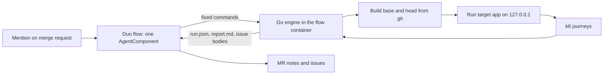

# Downstream: design details

Status of this document: written 2026-10-22, four days before the submission deadline
(Tue 2026-10-27, 13:00 UTC). Day-0 platform tests are done and logged. The engine is not
written. Everything under "Platform facts" is backed by a committed log; everything else is
design. Items marked **UNVERIFIED** have not been exercised on the platform yet and are
tracked in [requirements.md](requirements.md) as numbered tests (T-xx).

Related: [requirements.md](requirements.md) (what must be true and how we check it),
[userflow.md](userflow.md) (what a reviewer and a maintainer see, and the demo script).

---

## 1. What it is, in plain English

A code review answers "does this change look right?". It cannot answer "what does this
change do to the rest of the app while real users are using it?".

Downstream is a GitLab Duo Agent Platform flow. You mention it on a merge request. It then:

1. Works out which routes the change touches and which other routes depend on them
   (the blast radius).
2. Writes a handful of realistic user journeys through those routes (log in, open a list,
   change something, come back) and shows them to the reviewer in plain English.
3. Runs those journeys against the old build and the new build, with the old build run
   twice so it knows how noisy the machine is.
4. Reports only differences that are bigger than the noise: something that now fails,
   or got slower, or uses more CPU or memory.
5. Opens one issue per regression with the repro, a likely cause, and numbered fix options.
   Real trade-offs (one thing faster, another slower) become a question on the merge
   request, not an issue.
6. A human replies `@<flow> fix option 2`. The flow applies that option and reruns the same
   journey.

One sentence: *before a reviewed change reaches users, it runs realistic user traffic through
the old and new builds, finds what else the change quietly broke or slowed, traces the
cause, and files a fix.*

This is **user-activity simulation, not load testing**. The load is small (a few virtual
users, tens of seconds). k6 is the runner because it is a good, scriptable HTTP client with
per-request timing, not because we want to measure capacity.

Catchphrases used in the demo: "Merged is not safe." and "What happens after LGTM?".

### What it does not do

- It does not decide that a change is safe. It reports measured differences on a small set
  of journeys. No regression found means none found on those journeys.
- It does not replace unit tests, integration tests or a staging environment.
- It does not test anything that needs a real external service. The target runs on the
  flow's container with only loopback networking.
- It does not merge anything. Supervised tier: a human decides at every step.

---

## 2. Platform facts (verified 2026-10-22)

All from the Showcase project, Free tier, role Developer, hosted runners. Raw logs are in
[`evidence/day0/`](../evidence/day0/); the per-test table with line references is
[`evidence/day0-tests.md`](../evidence/day0-tests.md).

| Fact | Evidence |
|---|---|
| A custom flow is YAML (`version: v1`, `environment: ambient`) with `AgentComponent`s, `routers`, `flow.entry_point`, and a `prompts` list. | `flows/probe.yml` ran in sessions 9880588, 9881417, 9883560 |
| A mention of the flow's service account (`ai-<flow>-<topgroup>`) on a merge request starts a session. | run1 line 65, run2 line 53, run3 line 57 |
| The goal given to the flow contains every non-system discussion message through the triggering one, each with message id and author, then `Context: {MergeRequest IID: n}`. | same lines |
| A flow can chain tool calls (run a shell command, post a merge request note, repeat) and finish. A first probe stopped after one action; the version that added `context:project_id` and a firmer prompt completed five steps. Which of the two changes fixed it is not proven. | run1 (1 action), run2 (5 steps) |
| Flows run as CI jobs ("agent session" pipelines, `refs/workloads/*`) on `saas-linux-small-amd64`, image `workflow-generic-image:v0.0.23`, `duo` CLI 9.30.0, `glab` 1.120.0, sandbox `srt` 0.0.78. | run1 lines 1-2, 79-86, 127 |
| The container has 2 vCPU, about 7.8 GiB RAM visible with no cgroup limit, 18 GB free under `/tmp`, Linux 5.15, root user, Go 1.22.12, Node 20.20.2, Python 3.9.25. No docker, no psql. | `evidence/day0/probe-notes.txt` (user-pasted note outputs) |
| `.gitlab/duo/agent-config.yml` (default branch) `setup_script` runs as plain job-script lines before the sandbox wrapper, so it can download and install binaries. k6 v0.56.0 was installed to `/tmp/bin` and ran. | run3 lines 42-45; k6 version in `probe-notes.txt` |
| The sandbox network allowlist defaults to GitLab hosts only. Adding `network_policy.include_recommended_allowed: true` plus explicit domains opened npm, PyPI, `proxy.golang.org`, GitHub and `dl.k6.io`. | run3 line 91; HTTP 200 results in `probe-notes.txt` step B |
| A server on `127.0.0.1` inside the sandbox answers local requests (HTTP 200). | `probe-notes.txt` step C |
| `run_command` accepts a timeout argument; a 150 s command completed (11:31:48 to 11:34:18). | `probe-notes.txt` step D; run3 line 599 |
| The session UI only shows "Ran tool" with no detail. The flow's own merge request notes are the real visibility, so Downstream posts everything it does as notes. | user observation, 2026-10-22 |

### Not yet verified (each is a numbered test)

- Reading the diff and files from the flow (T-07), creating issues and tagging the starter
  (T-08), mention-in-an-issue and replying in an issue thread (T-09), committing to the
  merge request source branch (T-10).
- Credit cost of one full run (T-11). The dashboard lagged hours behind during day 0.
- Public visibility, licence and what "deployment" means for a flow-based entry in the
  official brief (T-12).
- Pages publishing on the Free tier (T-13), a narrowed network allowlist (T-14),
  `AGENTS.md` injection into custom flows (T-15).

---

## 3. Architecture



Three rules shape everything:

1. **The model does not do arithmetic, tables, charts, or shell.** The engine produces every
   number, table and Mermaid block. The model chooses journeys as structured JSON, reads
   the engine's evidence to name a likely cause, and writes sentences. This is deliberate:
   a prior Transcend entry (Kassandra, self-reported) found the model produced broken
   Mermaid charts in about one run in five, so rendering is a script's job.
2. **The flow is stateless.** Every reply (`fix option 2`, `verify`) is a fresh
   mention-triggered session. It rebuilds state from the issue body and a hidden marker in
   it, never from memory.
3. **The engine only talks to loopback.** The target app and k6 both run inside the flow's
   container. Nothing leaves the sandbox except GitLab API calls made by the flow's own tools.

### 3.1 Components

| Component | What it is | Status |
|---|---|---|
| Flow | `flows/downstream.draft.yml`, one `AgentComponent`, one mention trigger | Draft, not enabled |
| Engine | Go program `engine/` with subcommands below. Standard library first. | Not written |
| k6 | v0.56.0 installed by `setup_script` | Installed and version-checked (day 0); never yet run against an app |
| Target app | The project under test, with a small `downstream.yml` describing how to build and start it | Demo target `examples/shelf` and root `downstream.yml` written (section 9) |
| Agent instructions | `AGENTS.md`, `agentnotes.md` | Written |
| Report | MR notes (tables + Mermaid), issues; optional Pages page | Not built |

### 3.2 Engine interface

The flow calls these and nothing else. Arguments are fixed by the prompt; the model
supplies file contents (`journeys.json`) but never command lines.

```text
downstream scan   --base <sha> --head <sha> --out scan.json
downstream schema journeys                      # prints the JSON schema the model must follow
downstream run    --journeys journeys.json --out run.json
downstream report --run run.json --out report.md
downstream issues --run run.json --out issues.json
downstream marker parse   < issue_body.md       # rebuilds state from the hidden marker
downstream fixcheck --issue-json marker.json --option N   # decides if option N is applicable
```

`scan.json` (sketch): changed files and hunks; route table of the head build; for each
changed or affected route, why it is in the blast radius.

`journeys.json` (sketch): a list of journeys, each with `id`, `goal`, `why_included`, and
ordered `steps`: `{method, path, body, expect_status, extract: {var: json_pointer}}`.
Paths must come from the route table. Variables are carried between steps.

`run.json` (sketch): per journey and step, for baseline run 1, candidate, baseline run 2:
count, failures, p50, p95, mean, plus process CPU seconds and peak RSS. Noise band per
metric. Classification per finding: `regression`, `trade-off`, or `noise`.

### 3.3 Target config

The target repository carries a small `downstream.yml` so the engine can build and start it
without guessing. The engine reads it from the **base** commit, so a merge request cannot
change how it is measured. Parser: `engine/target`. This repository's own file:

```yaml
root: examples/shelf                      # directory scanned for routes
build: go build -o {out} ./examples/shelf/cmd/shelf
start: "{out}"
port_env: PORT                            # engine sets this to a free loopback port
ready_path: /health
vus: 2
iterations: 20                            # per VU; fixed sample size per pass
duration: 60s                             # cap per pass
```

Only flat `key: value` lines and comments are accepted; anything else is an error with its
line number. `{out}` is the binary path the engine chooses. `build` and `start` run with
`sh -c` and come from a committed file, never from model output.

---

## 4. Finding what a change affects (the blast radius)

Goal: from a diff, produce the changed routes plus the routes that depend on them.

MVP, honest scope: one framework family, picked after the target app is chosen (section 9).
For a Go target (stdlib `net/http`, Gin, chi): parse with `go/ast`, build a route table from
registration calls, map each route to its handler function, then walk calls from each
handler to depth 2 within the module. A route is **changed** if its handler or anything it
calls (to depth 2) overlaps a diff hunk. A route is **affected** if it shares a changed
function, a changed SQL table or model type, or a changed middleware with a changed route.
Node (Express/Fastify) would use a regex route extractor and `require`/`import` edges; that is
a stretch goal, not a promise.

What this will miss: dynamic route registration, reflection, cross-service calls, changes
that only matter through configuration. Reports say "static analysis, depth 2" so nobody
reads the blast radius as complete.

---

## 5. Journeys

The model writes journeys; the engine decides whether to trust them.

1. The model gets `scan.json` and `agentnotes.md` and returns `journeys.json` matching the
   schema printed by `downstream schema journeys`.
2. The engine validates structure: methods from an allowlist, paths present in the route
   table, no absolute URLs, a cap on steps, body size and journey count.
3. The engine runs each journey once against the **baseline**. A journey that fails there is
   discarded and the discard is listed in the report. We never blame the change for a
   journey that was already broken.
4. Journeys are shown to the reviewer first in plain English (see `agentnotes.md`,
   "Reviewer summary"), so a human can say "yes, users do that" or "add one for X" before
   anyone reads numbers.

At least one journey must avoid the changed route and share only a dependency with it. That
is the point of the product: finding the thing nobody was looking at.

---

## 6. Measuring and deciding

### 6.1 Run protocol

Sequential, never concurrent (2 vCPU: running both builds at once would make them fight each
other and call it a regression):

```text
build base, build head
start base  -> run journeys (B1)   -> stop
start head  -> run journeys (C)    -> stop
start base  -> run journeys (B2)   -> stop
```

B1 and B2 bracket C so that drift on the machine over the run shows up in the noise band
rather than being blamed on the change. Each app start uses a fresh data store, seeded only
through the app's own API by the journeys.

### 6.2 Metrics

- Per step: request count, failure count, p50, p95, mean latency (from k6 trends the
  generated script defines per step).
- Per run: process CPU seconds and peak RSS of the app, sampled from `/proc/<pid>` every
  250 ms by the engine.
- Database time: **not measured in the MVP.** It is reported only if the target exposes it
  (for example a debug route). Otherwise the report says "DB time: not measured". We do not
  guess.

### 6.3 Classification

Initial defaults (also in `agentnotes.md`), to be tuned against logged runs and then stated
in the README with the evidence:

- **noise**: inside the baseline noise band (the difference between B1 and B2).
- **regression**: a step that passed in baseline fails in the candidate; or a metric worse
  than the worse baseline run by more than twice the noise band, and by at least 20 percent,
  and by at least 10 ms (latency) or 10 MB (memory).
- **trade-off**: one metric clearly better and another clearly worse on the same journey.
  Becomes a question on the merge request, never an issue.

These thresholds are a starting point and are not claimed to be statistically rigorous. A
three-run design cannot give a confidence interval; the report says so in one line.

Implemented in `engine/classify` with these rules plus two more, both in the report's method
paragraph: **improved** is the mirror of regression (better than the better baseline run by
the same margins), and **withheld** means the two baseline runs differ by more than 50 percent
of the smaller one, so no verdict is given for that metric. Every metric counts higher as
worse. CPU seconds have no absolute floor. A journey with a latency regression and a latency
improvement has both re-classed as trade-off. Unit tests cover each class with synthetic
inputs (FR-23).

### 6.4 Finding the cause

Two levels, the second only if time allows:

1. **Static suspects (MVP).** For each regressed step, the engine lists the changed
   functions on its call path (from section 4) with their diff hunks. The model reads that
   evidence and writes a "likely cause" in one or two sentences, labelled as likely.
2. **Hunk bisection (stretch).** Apply each changed file (or hunk) alone on top of the
   baseline, rebuild, rerun only the regressed journey, and report which one reproduces the
   regression. This is evidence rather than inference, but costs a build and a short run per
   candidate, so it is capped at the top few files and only runs if the five-minute budget
   allows.

---

## 7. Output

### 7.1 Merge request notes

1. **Journeys added** (posted before the run): plain-English summary per journey.
2. **Report** (posted after): script-rendered tables: per journey and step, baseline range,
   candidate, change, noise band, verdict; a Mermaid chart comparing p95 per step;
   discarded journeys; what was not measured; links to the issues opened.
3. **A final note is always posted**, including on failure. A failed run is reported as
   failed, with the engine's error text and the step it failed at.

### 7.2 Issues (one per regression)

Title: `[Downstream] <journey>: <metric> <direction> <amount>`. Body, in order: who started
the run (tagged with `@username` so they are notified), the repro, baseline and candidate
figures with the noise band, a likely cause, numbered fix options, how to reply. The last
line is a hidden marker:

```html
<!-- downstream:v1 {"mr":12,"base":"<sha>","head":"<sha>","journey":{...},"metric":"p95","step":"..."} -->
```

The marker embeds the one journey that regressed, so an issue is self-contained: replying
`fix option 2` needs the issue and nothing else. **UNVERIFIED (T-08, T-09):** whether a
custom flow can create issues, whether the starter's mention notifies them when the author
is a service account, and whether it can read the issue body on a mention.

### 7.3 Report page (optional)

If the project allows it, the flow publishes a before/after page with GitLab Pages;
otherwise everything stays in the merge request. On the Free tier, Pages deploys from the
default branch only, so a per-MR page is not available there. **UNVERIFIED (T-13).** The
merge request note is the primary report and does not depend on Pages.

---

## 8. The fix loop

Humans reply in the issue thread. Every reply starts a new session.

| Reply | What the flow does |
|---|---|
| `@<handle> fix option N` | Parses the marker, checks option N is a change it can make on the merge request source branch, makes it, reruns the same journey, posts baseline, previous candidate and new candidate with the noise band. |
| `@<handle> verify` | After merge: reruns the stored journeys with the pre-merge target commit as baseline and the merge commit as candidate. Posts the delta. This closes the loop for "merged is not safe". |
| `@<handle> correction: <text>` | Stretch. A maintainer says a journey is unrealistic or a verdict is wrong; the flow redoes the step with that correction in the goal. |

If the flow cannot commit to the source branch (**UNVERIFIED, T-10**), the fallback is to
post the change as a unified diff in the issue for a human to apply. The owner observed the
built-in Developer flow creating branches, commits and a Draft MR on day 0 (screenshots are
not committed, so this is not in `evidence/`), so the capability exists on the platform;
whether it is reachable from a custom flow's toolset is the open question.

Fix options are written by the model and checked by the engine only for whether they apply
cleanly. The report does not claim an option is correct; it claims what the rerun measured.

---

## 9. Demo target app

Criteria: permissive licence, HTTP JSON API, a store that needs no server, Go or Node, builds
in about a minute, and a change that causes a measurable side effect somewhere the author did
not look. Two RealWorld ("Conduit") API implementations were checked on 2026-10-22 and
rejected: both default to Postgres, one states no licence, and the container has no Postgres
and no docker.

**Chosen: a purpose-built small API**, `examples/shelf`: a reading-list JSON API, Go standard
library only, in-memory store, 11 routes registered in `examples/shelf/routes.go`. The root
`downstream.yml` tells the engine how to build and start it.

The regression is **planted**, not found: `examples/changes/raise-hash-cost.patch` raises the
PBKDF2 iteration count of the shared `hashSecret` helper. In review it reads as a security
improvement. The diff does not show that `requireAuth` checks every API token through the same
helper, so every authenticated route pays the cost, including routes the diff never mentions.
`examples/changes/clean-change.patch` is the control: a change with no performance effect.
The weakness is plain: the regression was staged. The README says so.

---

## 10. Agent instructions

GitLab documents `AGENTS.md` as read by Duo Chat and by custom flows, but for custom flows
it is opt-in: the component must declare the optional input `context:inputs.user_rule`.
**UNVERIFIED (T-15).** No documentation was found saying `agentnotes.md` or any other name
is loaded automatically. So:

- `AGENTS.md`: conventions and hard rules for any agent touching this repo.
- `agentnotes.md`: operating notes for the Downstream flow. The flow prompt reads it
  explicitly at the start of every run (`read_file` once T-07 passes, otherwise
  `cat agentnotes.md` through `run_command`). Nothing depends on automatic loading.
- Both are protected by CODEOWNERS and are never edited by the flow.

---

## 11. Security model

- The model's only output that reaches execution is `journeys.json`, which the engine
  validates against a schema and against the route table. No model text reaches a shell.
- The engine sends traffic only to `127.0.0.1`. No absolute URLs are accepted in journeys.
- Diffs, issue text, notes and file contents are treated as data. The prompt says so, and
  the engine never interprets them as commands.
- Files that steer the agent are protected by CODEOWNERS and the flow does not edit them.
  The workspace is checked out on the merge request **source** branch (verified), so a
  plain `cat agentnotes.md` reads the source branch's copy, and a merge request could
  propose a change to the very file that steers the agent reviewing it. The intended
  mitigation is to read the target branch's copy with `git show` against the target ref.
  Whether that ref is available in the workspace is **unverified**; until it is tested,
  the file is protected by CODEOWNERS only.
- The network allowlist is wide: with `include_recommended_allowed: true` the sandbox
  config in run3 line 91 lists 175 entries. That is acceptable for the hackathon and noted
  as a hardening item (T-14): narrow it to the hosts actually needed once the engine's
  dependencies are known.
- Triggering needs Developer role or higher on the project. A judge who is not a member
  cannot trigger the flow; the README must show recorded evidence runs instead of asking
  anyone to trigger it.

---

## 12. Budget

- Whole run under about 5 minutes; each `run_command` under about 3 minutes (a 150 s command
  has been shown to work; longer ones are untested).
- Rough time plan inside that: builds 1-2 min, three journey runs 1-2 min, rendering seconds.
- Credits: **unmeasured.** The dashboard stayed at zero for hours after simple runs.
  T-11 re-reads it after the engine's first full run. If one run turns out to cost more than
  expected, the number of evidence runs drops accordingly.
- Money: zero. No paid tier, no paid service, hosted runners only.

---

## 13. Prior art and how this differs

- **Kassandra** (an earlier Transcend entry; figures are the author's own): diff to k6 to a
  report on the merge request. Targets SQLite or in-memory apps. Downstream differs by adding
  the noise-controlled baseline, a blast-radius step, per-regression issues with a reply
  loop, and a post-merge rerun.
- **GitLab Load Performance Testing:** a k6 template in the CI/CD catalog (paid tiers).
  Measures a fixed script, no diff awareness.
- **Diffy-style replay** (Offbrief, and the original open-source Diffy): compare two builds on
  the same traffic. We borrow the old-versus-new idea and the noise-control trick of running
  the old build twice.

We do not claim novelty for "run k6 on an MR". The claim is the combination in section 1,
and it stands or falls on the evidence runs.

---

## 14. Repo layout

The platform reads agent configuration from the default branch of this GitLab project and
runs the flow here.

```text
README.md              status, claims table, 30-second check
AGENTS.md              rules for agents working in this repo
agentnotes.md          operating notes the flow reads each run
.gitlab/duo/           agent-config.yml (verified)
.gitlab/CODEOWNERS     protects the files above
flows/                 probe.yml (verified), downstream.draft.yml (not enabled)
docs/                  details.md, requirements.md, userflow.md
evidence/              raw logs and the results table
scripts/               validate_yaml.py, check_evidence.py
engine/                (not yet written)
examples/              shelf/ (demo target), changes/ (planted and clean patches)
```
