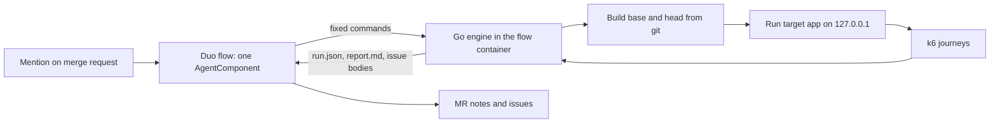

# Downstream: design details

Status of this document: written 2026-10-22, four days before the submission deadline
(Tue 2026-10-27, 13:00 UTC). Day-0 platform tests are done and logged. The engine is built
and tested; it has no logged run yet. Everything under "Platform facts" is backed by a committed log; everything else is
design. Items marked **UNVERIFIED** have not been exercised on the platform yet and are
tracked in [requirements.md](requirements.md) as numbered tests (T-xx).

Related: [requirements.md](requirements.md) (what must be true and how we check it),
[userflow.md](userflow.md) (what a reviewer and a maintainer see, and the demo script).

---

## 1. What it is, in plain English

A code review answers "does this change look right?". It cannot answer "what does this
change do to the rest of the app while real users are using it?".

Downstream is a GitLab Duo Agent Platform flow. You mention it on a merge request. It then:

1. Works out which routes the change touches and which other routes depend on them
   (the blast radius).
2. Writes a handful of realistic user journeys through those routes (log in, open a list,
   change something, come back) and shows them to the reviewer in plain English.
3. Runs those journeys against the old build and the new build, with the old build run
   twice so it knows how noisy the machine is.
4. Reports only differences that are bigger than the noise: something that now fails,
   or got slower, or uses more CPU or memory.
5. Opens one issue per regression with the repro, a likely cause, and numbered fix options.
   Real trade-offs (one thing faster, another slower) become a question on the merge
   request, not an issue.
6. A human replies `@<flow> fix option 2`. The flow applies that option and reruns the same
   journey.

One sentence: *before a reviewed change reaches users, it runs realistic user traffic through
the old and new builds, finds what else the change quietly broke or slowed, traces the
cause, and files a fix.*

This is **user-activity simulation, not load testing**. The load is small (a few virtual
users, tens of seconds). k6 is the runner because it is a good, scriptable HTTP client with
per-request timing, not because we want to measure capacity.

Catchphrases used in the demo: "Merged is not safe." and "What happens after LGTM?".

### What it does not do

- It does not decide that a change is safe. It reports measured differences on a small set
  of journeys. No regression found means none found on those journeys.
- It does not replace unit tests, integration tests or a staging environment.
- It does not test anything that needs a real external service. The target runs on the
  flow's container with only loopback networking.
- It does not merge anything. Supervised tier: a human decides at every step.

---

## 2. Platform facts (verified 2026-10-22)

All from the Showcase project, Free tier, role Developer, hosted runners. Raw logs are in
[`evidence/day0/`](../evidence/day0/); the per-test table with line references is
[`evidence/day0-tests.md`](../evidence/day0-tests.md).

| Fact | Evidence |
|---|---|
| A custom flow is YAML (`version: v1`, `environment: ambient`) with `AgentComponent`s, `routers`, `flow.entry_point`, and a `prompts` list. | `flows/probe.yml` ran in sessions 9880588, 9881417, 9883560 |
| A mention of the flow's service account (`ai-<flow>-<topgroup>`) on a merge request starts a session. | run1 line 65, run2 line 53, run3 line 57 |
| The goal given to the flow contains every non-system discussion message through the triggering one, each with message id and author, then `Context: {MergeRequest IID: n}`. | same lines |
| A flow can chain tool calls (run a shell command, post a merge request note, repeat) and finish. A first probe stopped after one action; the version that added `context:project_id` and a firmer prompt completed five steps. Which of the two changes fixed it is not proven. | run1 (1 action), run2 (5 steps) |
| Flows run as CI jobs ("agent session" pipelines, `refs/workloads/*`) on `saas-linux-small-amd64`, image `workflow-generic-image:v0.0.23`, `duo` CLI 9.30.0, `glab` 1.120.0, sandbox `srt` 0.0.78. | run1 lines 1-2, 79-86, 127 |
| The container has 2 vCPU, about 7.8 GiB RAM visible with no cgroup limit, 18 GB free under `/tmp`, Linux 5.15, root user, Go 1.22.12, Node 20.20.2, Python 3.9.25. No docker, no psql. | `evidence/day0/probe-notes.txt` (user-pasted note outputs) |
| `.gitlab/duo/agent-config.yml` (default branch) `setup_script` runs as plain job-script lines before the sandbox wrapper, so it can download and install binaries. k6 v0.56.0 was installed to `/tmp/bin` and ran. | run3 lines 42-45; k6 version in `probe-notes.txt` |
| The sandbox network allowlist defaults to GitLab hosts only. Adding `network_policy.include_recommended_allowed: true` plus explicit domains opened npm, PyPI, `proxy.golang.org`, GitHub and `dl.k6.io`. | run3 line 91; HTTP 200 results in `probe-notes.txt` step B |
| A server on `127.0.0.1` inside the sandbox answers local requests (HTTP 200). | `probe-notes.txt` step C |
| `run_command` accepts a timeout argument; a 150 s command completed (11:31:48 to 11:34:18). | `probe-notes.txt` step D; run3 line 599 |
| The session UI only shows "Ran tool" with no detail. The flow's own merge request notes are the real visibility, so Downstream posts everything it does as notes. | user observation, 2026-10-22 |

### Not yet verified (each is a numbered test)

- Reading the diff and files from the flow (T-07), creating issues and tagging the starter
  (T-08), mention-in-an-issue and replying in an issue thread (T-09), committing to the
  merge request source branch (T-10).
- Credit cost of one full run (T-11). The dashboard lagged hours behind during day 0.
- Public visibility, licence and what "deployment" means for a flow-based entry in the
  official brief (T-12).
- Pages publishing on the Free tier (T-13), a narrowed network allowlist (T-14),
  `AGENTS.md` injection into custom flows (T-15).

---

## 3. Architecture



Three rules shape everything:

1. **The model does not do arithmetic, tables, charts, or shell.** The engine produces every
   number, table and Mermaid block. The model chooses journeys as structured JSON, reads
   the engine's evidence to name a likely cause, and writes sentences. This is deliberate:
   a prior Transcend entry (Kassandra, self-reported) found the model produced broken
   Mermaid charts in about one run in five, so rendering is a script's job.
2. **The flow is stateless.** Every reply (`fix option 2`, `verify`) is a fresh
   mention-triggered session. It rebuilds state from the issue body and a hidden marker in
   it, never from memory.
3. **The engine only talks to loopback.** The target app and k6 both run inside the flow's
   container. Nothing leaves the sandbox except GitLab API calls made by the flow's own tools.

### 3.1 Components

| Component | What it is | Status |
|---|---|---|
| Flow | `flows/downstream.yml`, one `AgentComponent`, one mention trigger | Written, not yet run on the platform |
| Engine | Go program `engine/` with subcommands below. Standard library only. | Built and tested (`make test`); no logged run |
| k6 | v0.56.0 installed by `setup_script` | Installed and version-checked (day 0); never yet run against an app |
| Target app | The project under test, with a small `downstream.yml` describing how to build and start it | Demo target `examples/shelf` and root `downstream.yml` written (section 9) |
| Agent instructions | `AGENTS.md`, `agentnotes.md` | Written |
| Report | MR notes (tables + Mermaid), issues; optional Pages page | Report and issue bodies built (`engine/report`, `engine/issues`); posting them from the flow not yet run; Pages not built |

### 3.2 Engine interface

The flow calls these and nothing else. Arguments are fixed by the prompt; the model
supplies file contents (`journeys.json`, `notes.json`) but never command lines. Built in
`engine/cmd/downstream`; SHAs must be 7 to 40 hex characters, and a commit missing from a
partial clone is fetched from `origin`.

```text
downstream version
downstream scan     --base <sha> --head <sha> [--repo .] --out scan.json
downstream schema   journeys                    # the JSON schema the model must follow
downstream validate --journeys journeys.json --scan scan.json
downstream run      --base <sha> --head <sha> --journeys journeys.json [--repo .] [--k6 path] --out run.json
downstream report   --run run.json [--scan scan.json] --out report.md
downstream summary  --run run.json --scan scan.json   # one count per line: regression=N ...
downstream files    --scan scan.json                 # numbered list of files the model may read
downstream show     --scan scan.json --head <sha> --file N   # one of them at the head commit
downstream issues   --run run.json [--scan scan.json] [--notes notes.json] --mr <iid> --starter <user> --out issues.json
downstream marker   parse [--journeys-out journeys.json] < issue_body.md
downstream fixcheck --marker marker.json --option N  # checks option N exists; does not apply it
```

`run` writes `run.json` even when it stops early, with the stage and error, so `report` can
say where it stopped. `issues` writes the issue titles and bodies, the trade-off questions for
the merge request, and `needs_notes`: the finding IDs the model must write notes for.

The file formats are the Go types in `engine/model/model.go`:

- `scan.json`: changed files and hunks, changed functions, the head build's route table, and
  the changed and affected routes with the reasons each is there.
- `journeys.json`: journeys, each with `id`, `goal`, `why_included` and ordered `steps`
  `{name, method, path, headers, body, expect_status, extract: {var: json_pointer}}`.
- `run.json`: settings and thresholds, kept and discarded journeys, the three passes in run
  order with per-step count, failures, p50, p95 and mean plus app CPU seconds and peak RSS,
  and one finding per metric with B1, C, B2, noise band, delta and class.
- `notes.json`: per headline finding, a likely cause and fix options, written by the model.

### 3.3 Target config

The target repository carries a small `downstream.yml` so the engine can build and start it
without guessing. The engine reads it from the **base** commit, so a merge request cannot
change how it is measured. Parser: `engine/target`. This repository's own file:

```yaml
root: examples/shelf                      # directory scanned for routes
main_dir: examples/shelf/cmd/shelf        # package main; the engine adds runtime counters here
build: go build -o {out} ./examples/shelf/cmd/shelf
start: "{out}"
port_env: PORT                            # engine sets this to a free loopback port
ready_path: /health
vus: 2
iterations: 10                            # per VU; fixed sample size per pass
duration: 60s                             # cap per pass
```

Only flat `key: value` lines and comments are accepted; anything else is an error with its
line number. `{out}` is the binary path the engine chooses. `build` and `start` run with
`sh -c` and come from a committed file, never from model output.

---

## 4. Finding what a change affects (the blast radius)

Goal: from a diff, produce the changed routes plus the routes that depend on them.

MVP, honest scope: one framework family, picked after the target app is chosen (section 9).
For a Go target (stdlib `net/http`, Gin, chi): parse with `go/ast`, build a route table from
registration calls, map each route to its handler function, then walk calls from each
handler to depth 2 within the module. A route is **changed** if its handler or anything it
calls (to depth 2) overlaps a diff hunk. A route is **affected** if it shares a changed
function, a changed SQL table or model type, or a changed middleware with a changed route.
Node (Express/Fastify) would use a regex route extractor and `require`/`import` edges; that is
a stretch goal, not a promise.

Implemented in `engine/scan` for Go `net/http` ServeMux registrations with string-literal
patterns (`mux.HandleFunc("GET /books/{id}", h)`, `mux.Handle(p, mw(http.HandlerFunc(h)))`).
Calls are resolved by name, without the type checker, which over-approximates. A function
counts as changed when its lines overlap a hunk or when it uses a top-level const, var or type
whose declaration overlaps one, so changing a constant marks its users. A route is **changed**
when its handler or its middleware reaches a changed function within depth 2, and
**affected** when it shares a function, a type or a package variable with a changed route. A
function reached by more than half of all routes (such as a JSON writer) is ignored for the
shared-function rule because sharing it carries no signal. Chi, Gin and Node frameworks are
not supported.

What this will miss: dynamic route registration, reflection, cross-service calls, changes
that only matter through configuration. Reports say "static analysis, depth 2" so nobody
reads the blast radius as complete.

---

## 5. Journeys

The model writes journeys; the engine decides whether to trust them.

1. The model gets `scan.json` and `agentnotes.md` and returns `journeys.json` matching the
   schema printed by `downstream schema journeys`.
2. The engine validates structure: methods from an allowlist, paths present in the route
   table, no absolute URLs, a cap on steps, body size and journey count.
3. The engine runs each journey once against the **baseline**. A journey that fails there is
   discarded and the discard is listed in the report. We never blame the change for a
   journey that was already broken.
4. Journeys are shown to the reviewer first in plain English (see `agentnotes.md`,
   "Reviewer summary"), so a human can say "yes, users do that" or "add one for X" before
   anyone reads numbers.

Coverage rules (`agentnotes.md` "Coverage per route", flow step R6): for each changed or
affected route the journeys must include the happy path, a negative step, an edge-input step,
a repeated request if the route creates data, enough data to pass a list's page size, and a
second user if the route is scoped to an owner, with expected statuses read from the head code.
`downstream validate` warns, without failing, when a changed route is covered only by 2xx steps
or not at all, or an affected route is not covered (`engine/journey/lint.go`).
`examples/shelf/journeys.thorough.json` has all of these against the demo app, and
`examples/shelf/thorough_test.go` replays it against the app. Whether the flow's model
reliably writes such steps has **not been tested**. Known limit: the model may read only
changed files and route registration files, so a handler in an unchanged file cannot settle a
status.

At least one journey must avoid the changed route and share only a dependency with it. That
is the point of the product: finding the thing nobody was looking at.

Implemented in `engine/journey` (schema and validation) and `engine/k6gen` (script). Limits:
1 to 6 journeys, 1 to 12 steps each, bodies up to 4 KiB, methods GET, POST, PUT, PATCH,
DELETE, header names limited to Authorization, Content-Type, Accept and `X-*`. Each path must
match a route in the head build's route table. Values carry between steps as `{{name}}`
placeholders filled from an earlier step's `extract` (an RFC 6901 JSON pointer into the
response), plus a built-in `{{uniq}}` for unique usernames. A step fails when its status is not
`expect_status` or an extract is missing, and the rest of that iteration is skipped.

The k6 script is generated by the engine: the journeys are embedded as a JSON literal and run
by one fixed interpreter function (`engine/k6gen/interpreter.js`), so no model text becomes
script source. Each step has its own k6 Trend and Counters, and `handleSummary` writes the
per-step figures to a file the engine reads. The base URL must be `http://127.0.0.1:<port>`;
anything else is rejected before a script is written.

---

## 6. Measuring and deciding

### 6.1 Run protocol

Sequential, never concurrent (2 vCPU: running both builds at once would make them fight each
other and call it a regression):

```text
build base, build head
start base  -> one iteration of each journey (baseline check) -> stop
start base  -> run journeys (B1)   -> stop
start head  -> run journeys (C)    -> stop
start base  -> run journeys (B2)   -> stop
```

B1 and B2 bracket C so that drift on the machine over the run shows up in the noise band
rather than being blamed on the change. Each app start uses a fresh data store, seeded only
through the app's own API by the journeys.

Implemented in `engine/runner`. Each commit is extracted with `git archive` into a temporary
directory, so the repository and its working tree are never changed. The app is started with
`exec` so its process is the one measured, on a free port on 127.0.0.1, and stopped with
SIGTERM then SIGKILL. In each pass every journey is its own k6 scenario with a fixed number of
iterations per VU (`downstream.yml`), so B1, C and B2 attempt the same journeys the same
number of times. Counts can still differ: a failing step skips the rest of its iteration, and
the per-pass cap can cut a pass short; findings say when counts differ. The scenarios run at
the same time, the same way in every pass. Requests time out after 20 s.

Traffic stays on 127.0.0.1: the base URL is checked, k6 runs with `maxRedirects: 0` and
`--no-usage-report`, and the readiness check does not follow redirects, so a target that
answers with a redirect to another host is never followed.

### 6.2 Metrics

- Per step: request count, failure count, p50, p95, mean latency (from k6 trends the
  generated script defines per step).
- Per pass: CPU seconds the app used while k6 ran (user plus system time from
  `/proc/<pid>/stat`, read before and after, in 10 ms ticks) and its peak RSS (`VmHWM` from
  `/proc/<pid>/status` after k6 exits).
- Per pass, process counters (`engine/runner/proc.go`, `stats.go`):
  - CPU seconds over the k6 window at nanosecond resolution: the first field of
    `/proc/<pid>/task/*/schedstat` (time on CPU) summed over the app's threads just before
    k6 starts and just after it exits (`cpu_seconds_window`). A thread that exits inside the
    window loses its time; Go runtime threads rarely exit. If schedstat cannot be read, the
    app's rusage when it exits (whole process life, microseconds) is used, then the tick
    counter. `cpu_source` says which; CPU per journey is compared only when B1, C and B2
    used the same source;
  - bytes written and write syscalls (`wchar`, `syscw` from `/proc/<pid>/io`) over the k6
    window. `rchar` and `syscr` are read but not reported;
  - open file descriptors (`/proc/<pid>/fd`) and threads (`Threads:` in
    `/proc/<pid>/status`), read 500 ms after k6 exits so keep-alive connections can close;
  - completed journeys: iterations that finished every step without a failure, from a k6
    counter per journey, and from them CPU ms, bytes written and write syscalls per
    completed journey.
  A counter that cannot be read is recorded as not measured for that pass and listed under
  "Not measured" in the report; the run does not fail.
- Per pass, Go runtime counters (`engine/runner/metrics.go`), only when `downstream.yml` sets
  the optional key `main_dir`, the directory of the target's package main (relative to the
  repo, no `..`, checked like `root`). Without it they are recorded as not measured, with the
  reason in the report.
  - How: for the base and the head build alike, the engine writes one file,
    `zz_downstream_metrics.go` (package main, standard library only, every identifier
    prefixed `zzDownstream`), and an overlay JSON that maps
    `<extracted tree>/<main_dir>/zz_downstream_metrics.go` to it. The build runs with
    `-overlay=<json>` added to `GOFLAGS` in its environment (any existing `GOFLAGS` is kept),
    so the build command from `downstream.yml` is not rewritten and neither the repository
    nor the extracted tree gains a file;
  - the file's `init` does nothing unless the environment variable
    `DOWNSTREAM_METRICS_ADDR` is set. The engine sets it, on the measured app process only,
    to a free `127.0.0.1` port other than the app's own. It then serves `GET /metrics`
    there: a JSON object with four unsigned integers read from `runtime/metrics`:
    `/gc/heap/allocs:objects`, `/gc/heap/allocs:bytes`, `/gc/cycles/total:gc-cycles` and
    `/sched/goroutines:goroutines`;
  - the engine reads that endpoint three times per measured pass, on the side port, so the
    reads are not journey traffic: just before the k6 window, just after it, and after the
    same 500 ms drain as the descriptor and thread counts. Allocated objects, allocated bytes
    and GC cycles are the difference between the first two readings, divided by the
    completed journeys; goroutines is the third reading;
  - the gated metrics are `alloc_objects_per_journey`, `alloc_bytes_per_journey`,
    `gc_cycles` (GC cycles in the k6 window, per pass) and `goroutines`;
    `gc_cycles_per_journey` is shown but not judged;
  - the injection never fails a run. If `main_dir` is not a directory in the commit, the
    overlay cannot be written, or the build with the injected file fails (for example the
    package in `main_dir` is not named main), that commit is built again without it. If the
    endpoint does not answer or a counter goes backwards, the pass keeps its other counters.
    In each case the four figures are listed as not measured for that pass and a line in
    "Not measured" says why;
  - limits: the reads add a few allocations of their own, the same in every pass, and the
    goroutine count includes the goroutine that serves the side port. A `GOFLAGS` set with
    `go env -w` rather than in the environment is replaced by the environment value for
    these builds.
- Database time: **not measured in the MVP.** It is reported only if the target exposes it
  (for example a debug route). Otherwise the report says "DB time: not measured". We do not
  guess.

### 6.3 Classification

Implemented in `engine/classify`. The A/A runs in `evidence/aa/` (identical code as B1, C and
B2) showed that the process counters vary far less than latency on the same code: bytes
written per journey by under 1 percent, CPU per completed journey by up to about a fifth,
step p95 by several times its own value at worst (`evidence/aa/counters/summary.txt`). So
metrics are of two kinds:

- **Gated** metrics decide whether a run has a regression: the process counters (bytes
  written and write syscalls per completed journey, open file descriptors, threads), the
  runtime counters read through the build overlay (objects and bytes allocated per completed
  journey, GC cycles per pass, goroutines), CPU milliseconds per completed journey, peak
  memory, and step failures.
- **Advisory** metrics are shown but never decide: p50, p95 and mean latency per step, and the
  app's total CPU seconds (which depends on how many journeys completed; CPU per completed
  journey replaces it as the gated CPU metric).

**The gated rule** (counters, CPU per journey, memory). Let `worse = max(B1, B2)`,
`better = min(B1, B2)` and `band = |B1 - B2|`. Each metric has a tolerance with a relative and
an absolute part, and `allowed = max(relative x worse, absolute)`. Then:

- **regression**: `C - worse > allowed` and `C - worse > band`.
- **improved**: the opposite, against `better`.
- **withheld**: neither of the above, and `band > allowed`: the two baselines of this run
  disagree by more than the tolerance, so a change of the tolerance's size could not be seen.
  The reason names both figures.
- **noise**: otherwise.
- **not-measured**: a counter listed in a pass's `unmeasured`. Nothing is compared and it is
  never a regression.

Every finding carries `allowed`, `band` and the **smallest detectable change**,
`max(allowed, band)`, also as a percentage of the worse baseline. It is the smallest change
this run could tell apart from noise. A change beyond it is a regression even when the
baselines are noisy, so a large regression is not hidden by noisy baselines. A change below it
is not evidence of no change; the report says so beside every figure.

The tolerances are `Thresholds.Tolerances` in `run.json` (`settings.thresholds`), set by
`DefaultThresholds` in `engine/classify/classify.go`. Each was picked from the A/A runs in
`evidence/aa/counters/summary.txt` and `evidence/aa/runtime/summary.txt` (largest excess of C
over the worse baseline on identical code), at between about 1.8 and 2.9 times that excess,
rounded up; the ratio for each metric is in the comment on `DefaultThresholds`. Small integer
counts (open file descriptors, threads, goroutines, GC cycles per pass) have an absolute
tolerance instead, because one thread is a large fraction of ten. Peak RSS is allowed 5%,
more than its A/A excess suggests, because A/A runs use one binary and two builds of a clean
change differed by up to 2.17% (`evidence/plants/README.md`); GC cycles were 0 in every
A/A pass, so their tolerance of 2 cycles is chosen, not derived. CPU per journey was
calibrated on whole-process CPU and is now measured over the k6 window; no committed A/A set
used the window figure before `evidence/aa/final`. No command-line flag changes them.

**Step failures** are gated: a step that passed on both baseline runs and failed on the
candidate is a regression, whatever its latency. Its smallest detectable change is one
failure.

**Trade-off**, for gated app metrics only: a regression is re-classed together with an
improvement when some gated app metric improved by at least as large a fraction of its own
baseline as the regression rose. A smaller improvement never excuses a regression. It
becomes a question on the merge request, never an issue. Step failures and latency are not
re-classed.

**Advisory latency** keeps the older rule so a report can say "slower" or "faster": worse than
the worse baseline by more than twice the noise band, by at least 20 percent and by at least
10 ms, with the earlier **withheld** rule (baselines more than 50 percent apart) and
**not-reached** (a step with no requests in some pass has its latencies left uncompared).
Its findings have `gated: false`. They are never counted in `regression=`, never open an
issue and are never the only reason for one. Their smallest detectable change is the largest
of twice the noise band, the absolute floor and the relative minimum; the report prints it
too. The `advisory=` line of `downstream summary` counts advisory findings classed as
regression.

A `run.json` written before findings had a `kind` has no gated or advisory split. The engine
treats such findings as deciding, as they did then, and the report renders them in the older
layout.

Unit tests cover each branch with synthetic inputs, and a replay test feeds the A/A runs in
`evidence/aa/{before,counters,after,runtime}/passes.tsv` through the classifier and requires zero gated regressions. These
thresholds are not claimed to be statistically rigorous. A three-run design cannot give a
confidence interval; the report says so in one line.

### 6.4 Finding the cause

Two levels, the second only if time allows:

1. **Static suspects (MVP).** For each regressed step, the engine lists the changed
   functions on its call path (from section 4) with their diff hunks. The model reads that
   evidence and writes a "likely cause" in one or two sentences, labelled as likely.
2. **Hunk bisection (stretch).** Apply each changed file (or hunk) alone on top of the
   baseline, rebuild, rerun only the regressed journey, and report which one reproduces the
   regression. This is evidence rather than inference, but costs a build and a short run per
   candidate, so it is capped at the top few files and only runs if the five-minute budget
   allows.

---

## 7. Output

### 7.1 Merge request notes

1. **Journeys added** (posted before the run): plain-English summary per journey.
2. **Report** (posted after): script-rendered tables, in this order after the header: the
   gated findings (metric, B1, B2, C, change, noise band, allowed, smallest detectable,
   verdict), step failures, latency per journey labelled advisory (with its own smallest
   detectable column), the raw per-pass process figures, a Mermaid chart comparing p95 per
   step, the issues to open, discarded journeys, what was not measured, and the method;
   the flow posts the list of issues it opened in a separate note.
3. **A final note is always posted**, including on failure. A failed run is reported as
   failed, with the engine's error text and the step it failed at.

Implemented in `engine/report`. Each figure comes from `run.json` and is formatted with
fixed decimals (ms 1, s 2, MB 1, and per journey: CPU ms 2, bytes 0, write syscalls 2). Every
finding row prints its noise band and smallest detectable change. Besides the tables and chart
above, the report has two findings lines (gated, then advisory latency), the blast radius from
`scan.json`, and the method and the tolerances in effect in words. A `run.json` from before
findings had a `kind` renders in the older layout.
The chart is a Mermaid `xychart-beta` block, capped at 20 steps; whether GitLab's Mermaid
version renders `xychart-beta` in a note is **unverified**. A golden-file test checks the
output, and a second test checks that every number in it is derived from the input.

### 7.2 Issues (one per cause)

Title: `[Downstream] <journey>: <metric> <direction> <amount>` for a single step, or
`[Downstream] <N> steps failing via <changed functions>: worst <step> ...` for a group. Body, in
order: who started the run (tagged with `@username` so they are notified), the changed
functions, the figures for every step in the group with the noise band, the repro, a likely
cause, numbered fix options, how to reply. The last
line is a hidden marker:

```html
<!-- downstream:v1 {"mr":12,"base":"<sha>","head":"<sha>","journey":{...},"metric":"p95","step":"..."} -->
```

Implemented in `engine/issues`. Only gated regressions open issues. Failing steps are grouped
by cause rather than opened per step: they are keyed by the changed functions (from
`scan.json`) on the routes they call, and each key gets one issue. Steps whose routes reach no
changed function share one more issue ("on routes outside the diff's call paths"). The gated
app-wide regressions (counters, CPU per completed journey, memory) are measured per process,
not per journey, so they form one more issue, "app", that lists every one of them with B1, B2,
C, the allowed rise, the noise band and the smallest detectable change; its headline (the title
and the marker) is the one with the largest change measured in allowed rises. At most 5 issues
per run, the app issue included. Latency never opens an issue: advisory regressions are listed
in a section "Latency on the same run (advisory)", grouped by journey and one figure per step,
inside the issue that already covers their journey (so a failing step and its latency changes
are together), and the app issue lists the rest. Each step issue has an engine-rendered table of
every step in the group, and its headline is the step that got slowest in absolute terms, with
failures always first. The likely cause and fix options come from a `notes.json` the model
writes, keyed by headline finding ID and validated by the engine: no comment or fence markup,
no table rows, and no figures with units, so the model cannot add numbers.
`ParseMarker` accepts a whole issue body or the bare marker JSON. `Questions` writes one merge
request question per trade-off: one for the app process, and one per journey for a `run.json`
from before gating.

The marker embeds the one journey that regressed, so an issue is self-contained: replying
`fix option 2` needs the issue and nothing else. **UNVERIFIED (T-08, T-09):** whether a
custom flow can create issues, whether the starter's mention notifies them when the author
is a service account, and whether it can read the issue body on a mention.

### 7.3 Report page (optional)

If the project allows it, the flow publishes a before/after page with GitLab Pages;
otherwise everything stays in the merge request. On the Free tier, Pages deploys from the
default branch only, so a per-MR page is not available there. **UNVERIFIED (T-13).** The
merge request note is the primary report and does not depend on Pages.

---

## 8. The fix loop

Humans reply in the issue thread. Every reply starts a new session.

| Reply | What the flow does |
|---|---|
| `@<handle> fix option N` | Parses the marker, checks option N is a change it can make on the merge request source branch, makes it, reruns the same journey, posts baseline, previous candidate and new candidate with the noise band. |
| `@<handle> verify` | After merge: reruns the stored journeys with the pre-merge target commit as baseline and the merge commit as candidate. Posts the delta. This closes the loop for "merged is not safe". |
| `@<handle> correction: <text>` | Stretch. A maintainer says a journey is unrealistic or a verdict is wrong; the flow redoes the step with that correction in the goal. |

If the flow cannot commit to the source branch (**UNVERIFIED, T-10**), the fallback is to
post the change as a unified diff in the issue for a human to apply. The owner observed the
built-in Developer flow creating branches, commits and a Draft MR on day 0 (screenshots are
not committed, so this is not in `evidence/`), so the capability exists on the platform;
whether it is reachable from a custom flow's toolset is the open question.

Fix options are written by the model. The engine checks only that option N exists
(`downstream fixcheck`); it does not check that a change applies or builds, and applying a
change from the flow is not built. The report does not claim an option is correct; it claims what the rerun measured.

---

## 9. Demo target app

Criteria: permissive licence, HTTP JSON API, a store that needs no server, Go or Node, builds
in about a minute, and a change that causes a measurable side effect somewhere the author did
not look. Two RealWorld ("Conduit") API implementations were checked on 2026-10-22 and
rejected: both default to Postgres, one states no licence, and the container has no Postgres
and no docker.

**Chosen: a purpose-built small API**, `examples/shelf`: a reading-list JSON API, Go standard
library only, in-memory store, 11 routes registered in `examples/shelf/routes.go`. The root
`downstream.yml` tells the engine how to build and start it.

The regression is **planted**, not found: `examples/changes/raise-hash-cost.patch` raises the
PBKDF2 iteration count of the shared `hashSecret` helper. In review it reads as a security
improvement. The diff does not show that `requireAuth` checks every API token through the same
helper, so every authenticated route pays the cost, including routes the diff never mentions.
`examples/changes/clean-change.patch` is the control: a change with no performance effect.
The weakness is plain: the regression was staged. The README says so.

---

## 10. Agent instructions

GitLab documents `AGENTS.md` as read by Duo Chat and by custom flows, but for custom flows
it is opt-in: the component must declare the optional input `context:inputs.user_rule`.
**UNVERIFIED (T-15).** No documentation was found saying `agentnotes.md` or any other name
is loaded automatically. So:

- `AGENTS.md`: conventions and hard rules for any agent touching this repo.
- `agentnotes.md`: operating notes for the Downstream flow. The flow prompt reads it
  explicitly at the start of every run (`read_file` once T-07 passes, otherwise
  `cat agentnotes.md` through `run_command`). Nothing depends on automatic loading.
- Both are protected by CODEOWNERS and are never edited by the flow.

---

## 11. Security model

- To read the head code before choosing expected statuses, the model runs `downstream files`,
  which numbers the files it may read (changed files and the files registering changed or
  affected routes), and `downstream show --file <n>`, which prints one at the head commit with
  `git show` run from an argument list, not a shell. The model types only the number, so a
  file name chosen by a merge request author never reaches a shell.
- The model's only output that reaches execution is `journeys.json` and `notes.json`, which
  the engine validates (schema, route table, text rules). They reach the shell only as the
  body of a quoted heredoc (`<<'DOWNSTREAM_JSON'`), so the shell expands nothing in them; the
  prompt requires one-line JSON, and JSON cannot hold a raw newline inside a string, so valid
  output cannot contain the terminator line. A model that ignored the prompt could still
  write a terminator line; the platform's sandbox and the CODEOWNERS rules are the remaining
  limits. A flow file-writing tool would close this gap; none is used yet.
- The engine is built from the merge request's own checkout, so a merge request could change
  the engine that measures it. Reviewers see engine changes in the diff; building the engine
  from the target branch is not done yet.
- `agentnotes.md` and `downstream.yml` are read from the **base** commit (`git show
  <base>:agentnotes.md`, `target.Load`), so a merge request cannot change them for its own
  run. That needs the base commit in the flow's workspace; the engine fetches it from `origin`
  if the clone lacks it (untested on the platform).
- The engine sends traffic only to `127.0.0.1`. No absolute URLs are accepted in journeys,
  and redirects are never followed (k6 `maxRedirects: 0`; the readiness check refuses them).
- `build` and `start` from `downstream.yml` run through `sh -c`; the binary path the engine
  substitutes for `{out}` is single-quoted.
- Diffs, issue text, notes and file contents are treated as data. The prompt says so, and
  the engine never interprets them as commands.
- Files that steer the agent are protected by CODEOWNERS and the flow does not edit them.
- The network allowlist is wide: with `include_recommended_allowed: true` the sandbox
  config in run3 line 91 lists 175 entries. That is acceptable for the hackathon and noted
  as a hardening item (T-14): narrow it to the hosts actually needed once the engine's
  dependencies are known.
- Triggering needs Developer role or higher on the project. A judge who is not a member
  cannot trigger the flow; the README must show recorded evidence runs instead of asking
  anyone to trigger it.

## 11a. CI

`.gitlab-ci.yml` has four jobs. `verify` runs `make verify`. `k6` copies the k6 binary out of
the official `grafana/k6:0.56.0` image as an artifact. `go-test` runs gofmt, go vet and
`go test ./...` on `golang:1.22` with that k6 on PATH, so the integration tests that start an
app and run k6 run there too. `engine-e2e` runs twice, once per patch in
`examples/changes/`: it commits the patch on top of the pipeline commit, then runs `scan`,
`validate`, `run`, `report`, `issues` and `summary` with the hand-written
`examples/shelf/journeys.example.json` (no model involved), keeps `out/` as an artifact, and
fails unless all three passes ran and the planted change has at least one regression and the
clean change has none. None of these jobs has run yet; their first logs go in `evidence/`.

---

## 12. Budget

- Whole run under about 5 minutes; each `run_command` under about 3 minutes (a 150 s command
  has been shown to work; longer ones are untested).
- Rough time plan inside that: builds 1-2 min, three journey runs 1-2 min, rendering seconds.
- Credits: **unmeasured.** The dashboard stayed at zero for hours after simple runs.
  T-11 re-reads it after the engine's first full run. If one run turns out to cost more than
  expected, the number of evidence runs drops accordingly.
- Money: zero. No paid tier, no paid service, hosted runners only.

---

## 13. Prior art and how this differs

- **Kassandra** (an earlier Transcend entry; figures are the author's own): diff to k6 to a
  report on the merge request. Targets SQLite or in-memory apps. Downstream differs by adding
  the noise-controlled baseline, a blast-radius step, per-regression issues with a reply
  loop, and a post-merge rerun.
- **GitLab Load Performance Testing:** a k6 template in the CI/CD catalog (paid tiers).
  Measures a fixed script, no diff awareness.
- **Diffy-style replay** (Offbrief, and the original open-source Diffy): compare two builds on
  the same traffic. We borrow the old-versus-new idea and the noise-control trick of running
  the old build twice.

We do not claim novelty for "run k6 on an MR". The claim is the combination in section 1,
and it stands or falls on the evidence runs.

---

## 14. Repo layout

The platform reads agent configuration from the default branch of this GitLab project and
runs the flow here.

```text
README.md              status, claims table, 30-second check
AGENTS.md              rules for agents working in this repo
agentnotes.md          operating notes the flow reads each run
.gitlab/duo/           agent-config.yml (verified)
.gitlab/CODEOWNERS     protects the files above
flows/                 probe.yml (verified), downstream.yml (not yet run)
docs/                  details.md, requirements.md, userflow.md
evidence/              raw logs and the results table
scripts/               validate_yaml.py, check_evidence.py
engine/                cmd/downstream (CLI), scan, journey, k6gen, runner, classify, report, issues
examples/              shelf/ (demo target), changes/ (planted and clean patches)
```
