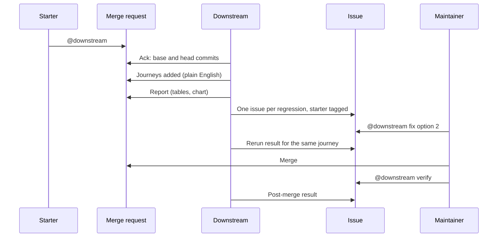

# Downstream: user flow

What the people involved see and do, step by step, plus the three-minute demo script.

**Reading guide.** Everything shown as a note or issue below is a **mock-up of the intended
output**, written before the engine exists. Values such as `<p95_base_ms>` are placeholders,
not measurements. The shipped README replaces these with real excerpts from logged runs.
Steps that depend on an unverified platform capability are tagged with the test that will
settle them (T-xx, see [requirements.md](requirements.md)).

Design context: [details.md](details.md).

---

## 1. People

| Role | What they do | Platform permission |
|---|---|---|
| **Author** | Opens the merge request with a change. | Developer or higher |
| **Starter** | Whoever mentions the flow. Often the reviewer. Gets tagged in every issue. | Developer or higher (C-07) |
| **Reviewer** | Reads the journeys and the report. Decides what to do. | Developer or higher |
| **Maintainer** | Replies with `fix option N`, merges, asks for `verify`. | Maintainer |
| **Downstream** | The flow, acting as its service account `ai-downstream-<topgroup>`. | Service account |

The Starter and the Reviewer are usually the same person.

---

## 2. Overview

---

## 3. Flow A: first run on a merge request

### A1. Mention

The Starter writes a comment on the merge request:

> `@ai-downstream-<topgroup>` please check this.

That one mention is all that is needed. It plans, runs and investigates (FR-01).
**Verified** (T-02): a mention starts a session; the goal includes the thread through that
message.

### A2. Acknowledgement (within seconds)

The platform posts its own "has started" reply with a session link. Downstream then posts:

> **Downstream started.** Comparing `<base_sha_short>` (target branch) with `<head_sha_short>`
> (this merge request). Run started by @`<starter>`. I will post the journeys first, then
> the results.

### A3. Journeys added (before any numbers)

> **Journeys added** (as many as the change needs, up to 20, grouped as existing, new feature and controls; shown so you can say if they are unrealistic)
>
> 1. **`<journey 1 goal>`**: a user does `<step>`, then `<step>`, then `<step>`.
>    *Why included:* it calls the changed route.
> 2. **`<journey 2 goal>`**: `<steps>`.
>    *Why included:* it shares the `<table or helper>` that the change modifies.
> 3. **`<journey 3 goal>`**: `<steps>`.
>    *Why included:* it does not touch the changed route; it shares `<middleware>` with it.
>
> Reply in this thread if one of these is not something users do, or if one is missing.

The Reviewer can reply. In the MVP the reply does not change the current run; it informs a
rerun. (`correction:` handling is a stretch goal, FR-44.)

### A4. Run (about 3 to 4 minutes, silent)

No further notes while the engine builds both versions and runs B1, C, B2. If anything
fails, go to Flow D.

### A5. Report note

> **Downstream report** for `<head_sha_short>` against `<base_sha_short>`
>
> | Journey | Step | Baseline p95 (range) | Candidate p95 | Change | Noise band | Verdict |
> |---|---|---|---|---|---|---|
> | `<j1>` | `<step>` | `<p95_base_min>`-`<p95_base_max>` ms | `<p95_cand>` ms | `<delta>` | `<band>` ms | regression |
> | `<j2>` | `<step>` | … | … | … | … | noise |
>
> (Table rendered by the engine.) A Mermaid chart of p95 per step follows, also rendered by
> the engine.
>
> **Discarded journeys:** `<none | list with reason>`.
> **Not measured:** database time (`<reason>`).
> **Method:** baseline run twice, candidate once, sequentially on one shared runner. Three
> runs give no confidence interval; treat verdicts near the thresholds as uncertain.
>
> **Regressions: `<n>`** (issues below). **Trade-offs: `<n>`** (questions below).

### A6. One issue per regression

Each issue (FR-32). **UNVERIFIED** until T-08 passes.

> **[Downstream] `<journey>`: `<metric>` `<direction>` `<amount>`**
>
> Run started by @`<starter>` on !`<mr>`.
>
> **Repro.** Journey steps `<1..n>`. Rerun with: `<fixed command>`.
>
> **Measured.** Baseline `<b1>` and `<b2>` ms, candidate `<c>` ms, noise band `<band>` ms.
>
> **Likely cause** (labelled likely, from static analysis of the diff): `<one or two
> sentences naming the changed function and why it affects this step>`.
>
> **Fix options**
> 1. `<option 1: what changes, expected effect, cost>`
> 2. `<option 2>`
> 3. `<option 3>`
>
> Reply `@ai-downstream-<topgroup> fix it` to apply option 1, or `fix option N` for another.
>
> Downstream state, read by fix it and verify (collapsed): `downstream:v1 {...}`

### A7. Trade-offs: a question, not an issue

> **Question for the reviewers:** on `<journey>`, `<metric A>` improved by `<x>` and
> `<metric B>` got worse by `<y>`. Is that acceptable for this change? No issue opened.

---

## 4. Flow B: choosing a fix

### B1. Reply in the issue

The Maintainer replies in the issue thread:

> `@ai-downstream-<topgroup>` fix it

`fix it` applies option 1; `fix option N` picks another. Verified in session 10000200
(`evidence/flow.md`).

### B2. What Downstream does

1. Reads the "Downstream state" marker to rebuild state: merge request, commits, the one
   journey and the fix options. It does not rely on any earlier session.
2. Checks with `downstream fixcheck` that option N exists; if not, it says so and stops.
3. Posts "Applying option N for @<requester>", reads the files involved, and commits the
   change on a new branch `downstream/fix-<issue>-option-<N>`.
4. Opens a merge request from that branch into the original merge request's branch, mentions
   the requester and requests their review.
5. Re-runs the issue's journey with the original merge request's head as the baseline (twice)
   and the fix as the candidate, and posts the engine's report on the fix merge request.

### B3. Result note in the issue

> @<requester> the fix is in !<fix MR>, with the re-measure posted there. Review and merge it
> if it holds up; Downstream does not merge.

If a step fails (no marker, option out of range, the fix does not build), the note says which
step and quotes the error. It never claims a fix it did not make (FR-41).

---

## 5. Flow C: after merge

The line the product is built around: *merged is not safe*.

1. The Maintainer merges.
2. They comment `@ai-downstream-<topgroup> verify` on the issue (or the merge request).
3. Downstream reruns the stored journeys with the pre-merge target commit as baseline and
   the merge commit as candidate, and posts the delta (FR-43).
4. If it is clean, the note says "no difference beyond noise on these journeys" and nothing
   stronger. If a regression survived, the note reopens the conversation in the issue.

---

## 6. Flow D: when something goes wrong

A final note is always posted (FR-04). Examples, each showing what the person sees:

| Situation | Note says |
|---|---|
| Build fails on head | "Run stopped at **build (head)**. Engine output: `<error text>`. No comparison was made." |
| Build fails on base | Same, at **build (base)**. A broken baseline is reported, never blamed on the change. |
| A journey fails on baseline | The journey is listed under **Discarded journeys** with the failing step. The run continues with the rest. |
| Every journey discarded | "No journey passed on the baseline, so there is nothing to compare." |
| Blast radius is empty | "Static analysis found no routes affected by this diff (depth 2). Running one smoke journey on the app's main route only." |
| Output too noisy | "Baseline runs differed by more than `<limit>` on `<metric>`; verdicts for that metric are withheld." |
| Time budget exceeded | "Stopped at the time budget after `<stage>`. Partial results below." |
| Mention in a place the flow cannot read | Short reply naming what it needs. |

---

## 7. Three-minute demo script

Target total 3:00. Recorded from a real logged run, not a mock-up. If any step below cannot
be shown for real because its platform test failed, that step is dropped from the video and
from the README rather than faked.

| Time | Screen | What is said |
|---|---|---|
| 0:00 | Title: "Merged is not safe." | "A review tells you if a change looks right. It does not tell you what it does to everything else." |
| 0:15 | An approved merge request on `<demo target>`. | "This one has an approval. The tests pass. What happens after LGTM?" |
| 0:30 | Type the one mention. | "One mention." |
| 0:40 | The acknowledgement and the Journeys note appear. | "It reads the diff, finds what depends on the change, and writes the journeys users would take. I can check them before anything runs." |
| 1:05 | The session UI showing only "Ran tool". Cut back to the notes. | "The session view hides the detail, so the flow narrates itself in the thread." |
| 1:15 | The report note appearing. | "Old build twice, new build once, so it knows how noisy the machine is." |
| 1:40 | One regression row highlighted, on a journey that does not touch the changed route. | "This route was not in the diff. It got slower because it shares `<dependency>` with the route that was." |
| 2:00 | The issue: repro, likely cause, numbered options, starter tagged. | "One issue for it, with a repro and fix options." |
| 2:15 | Type `@… fix it`. | "A maintainer picks an option." |
| 2:25 | The fix merge request and its re-measure note. | "It commits the fix on a branch, opens a merge request for me, and reruns the same journey with the noise band. It never merges." |
| 2:40 | A clean change, one line: "no difference beyond noise". | "On a clean change it says so and stops. It does not manufacture findings." |
| 2:50 | README claims table, evidence folder. | "Everything claimed here links to a logged run." |

Each of these exists in a logged flow run (`evidence/flow.md`): the journeys note, a report
with a regression on routes the diff does not reach, an issue with the starter tagged, a
`fix it` merge request with its re-measure, and a clean-change run.

---

## 8. Commands reference

| What you type | Where | Effect | Status |
|---|---|---|---|
| `@ai-downstream-<topgroup>` | Merge request | Plan, run, investigate, report | Verified (`evidence/flow.md`) |
| `@… fix it` / `@… fix option N` | Issue | Commit option 1 (or N) on a new branch, open a merge request for the requester, re-measure it | Verified (session 10000200) |
| `@… verify` | Issue | Rerun the issue's journey on the merged build | Written in the flow, not run |
| `@… correction: <text>` | Merge request or issue | Redo a step with the correction | Stretch |
| `@… publish report` | Merge request | Pages before/after page | Stretch; needs T-13 |

The handle format `ai-<flow>-<topgroup>` is verified for the probe flow
(`ai-downstream-probe-gitlab-ai-hackathon`); the Downstream flow's handle is
`ai-downstream-gitlab-ai-hackathon`.
