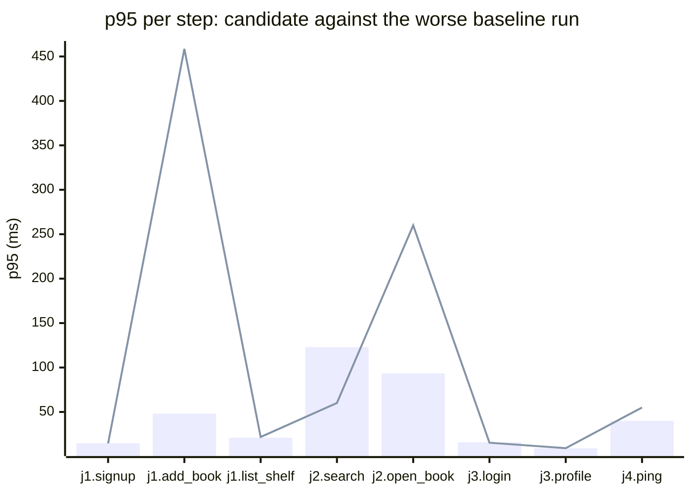

### Downstream report

Candidate `aaaaaaaa` against baseline `11111111`. Run started 2026-10-22T09:00:00Z, ended 2026-10-22T09:01:05Z. 2 VUs, 0 iterations per VU per pass (cap 15 s), v0.56.0.

**Findings:** regressed steps 2, trade-off journeys 1, improved metrics 0, withheld metrics 3. App process regressions: 2.

#### Reader adds a book to their shelf

| Step | Baseline p95 (B1 / B2) | Candidate p95 | Change | Noise band | Verdict |
|---|---|---|---|---|---|
| `signup` | 14.2 / 14.9 ms | 14.6 ms | -0.3 ms (-2%) | 0.7 ms | noise |
| `add_book` | 46.3 / 48.1 ms | 458.6 ms | +410.5 ms (+853%) | 1.8 ms | regression |
| `list_shelf` | 21.0 / 20.2 ms | 21.8 ms | +0.8 ms (+4%) | 0.8 ms | noise |

#### Reader searches the catalog and opens a book

| Step | Baseline p95 (B1 / B2) | Candidate p95 | Change | Noise band | Verdict |
|---|---|---|---|---|---|
| `search` | 120.5 / 123.0 ms | 60.1 ms | -62.9 ms (-51%) | 2.5 ms | trade-off |
| `open_book` | 90.0 / 93.4 ms | 260.0 ms | +166.6 ms (+178%) | 3.4 ms | trade-off |

#### Returning reader signs in and opens their profile

| Step | Baseline p95 (B1 / B2) | Candidate p95 | Change | Noise band | Verdict |
|---|---|---|---|---|---|
| `login` | 15.0 / 15.9 ms | 15.4 ms | -0.5 ms (-3%) | 0.9 ms | noise |
| `login` (failures) | 0 / 0 | 30 | +30 | 0 | regression |
| `profile` | 9.0 / 9.1 ms | 9.3 ms | +0.2 ms (+2%) | 0.1 ms | noise |

#### Health check while idle

| Step | Baseline p95 (B1 / B2) | Candidate p95 | Change | Noise band | Verdict |
|---|---|---|---|---|---|
| `ping` | 20.0 / 40.0 ms | 55.0 ms | +15.0 ms (+38%) | 20.0 ms | withheld |

**App process**

| Metric | B1 | C | B2 | Change | Noise band | Verdict |
|---|---|---|---|---|---|---|
| CPU time | 2.31 s | 4.87 s | 2.35 s | +2.52 s (+107%) | 0.04 s | regression |
| Peak RSS | 48.2 MB | 71.9 MB | 48.9 MB | +23.0 MB (+47%) | 0.7 MB | regression |

**p95 per step**

Bars: worse of the two baseline runs. Line: candidate.

- j1: Reader adds a book to their shelf
- j2: Reader searches the catalog and opens a book
- j3: Returning reader signs in and opens their profile
- j4: Health check while idle

**Issues to open**

- `shelf.add_book.p95_ms`
- `signin.login.failures`
- `app.peak_rss_mb`

2 regressed steps are grouped into 2 by the changed functions on the routes they call; one issue per group.

**Discarded journeys**

- `export`, step `download`: expected status 200, got 404 on the baseline

**Blast radius**

Changed routes:

- `POST /shelf/books`: handler addBook calls changed function store.AddBook

Affected routes:

- `GET /shelf`: reads the shelf table that store.AddBook writes

*Go AST route table and static call graph, depth 2; calls through interfaces and reflection are not followed.*

**Not measured**

- DB time: not measured; the target exposes no database timing.

**Method.** Baseline run twice (B1, B2) and candidate once (C), in the order B1, C, B2, sequentially on one machine. Three runs give no confidence interval; treat verdicts near the thresholds as uncertain.

Thresholds in effect: a metric is a regression when the candidate is worse than the worse baseline run by more than 2 times the noise band (the difference between B1 and B2), by at least 20%, and by at least 10 ms (latency), 10 MB (memory) or 0.5 s (CPU). A step that passed on both baseline runs and failed on the candidate is a regression. The verdict is withheld when the baseline runs differ by more than 50% of the smaller one and by at least the same minimum, unless the candidate is clearly worse or better than both. A journey with a latency regression and a latency improvement is reported as a trade-off.
