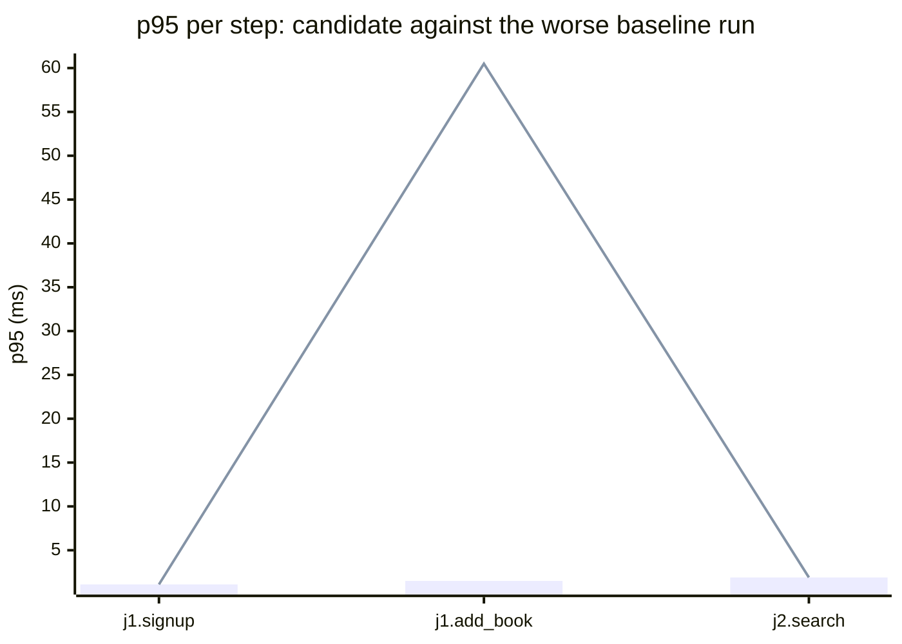

### Downstream report

Candidate `aaaaaaaa` against baseline `11111111`. Run started 2026-10-23T09:00:00Z, ended 2026-10-23T09:01:05Z. 2 VUs, 10 iterations per VU per pass (cap 60 s), v0.56.0.

**Findings (gated):** regressed app metrics 1, failing steps 1, trade-off metrics 0, improved metrics 0, withheld metrics 0, not measured 1.

**Latency (advisory):** slower 2, faster 0. Latency does not decide the verdict.

**Gated findings (counters, CPU per journey, memory)**

| Metric | B1 | B2 | C | Change | Noise band | Allowed | Smallest detectable | Verdict |
|---|---|---|---|---|---|---|---|---|
| CPU per completed journey | 2.00 ms/journey | 2.10 ms/journey | 9.00 ms/journey | +6.90 ms/journey (+329%) | 0.10 ms/journey | 0.42 ms/journey | 0.42 ms/journey (20.0%) | regression |
| Bytes written per journey | 1477 B/journey | 1477 B/journey | 1477 B/journey | +0 B/journey (+0%) | 0 B/journey | 1024 B/journey | 1024 B/journey (69.3%) | noise |
| Write syscalls per journey | not measured | not measured | not measured | - | - | - | - | not-measured |
| Open fds | 7 | 7 | 7 | +0 (+0%) | 0 | 1 | 1 (14.3%) | noise |
| Threads | 9 | 10 | 10 | +0 (+0%) | 1 | 2 | 2 (20.0%) | noise |
| Peak RSS | 10.2 MB | 10.2 MB | 10.2 MB | +0.0 MB (+0%) | 0.0 MB | 10.0 MB | 10.0 MB (98.0%) | noise |

Change is against the worse baseline run. A rise counts only when it is more than both the allowed rise and the noise band. Smallest detectable is the larger of the two: the smallest change this run could tell apart from noise.

- `app.cpu_ms_per_journey`: worse than the worse baseline by 6.90 ms/journey (328.6%), more than the allowed 0.42 ms/journey (20% of the worse baseline) and more than the noise band of 0.10 ms/journey
- `app.write_syscalls_per_journey`: not measured in pass C: the figure could not be read, so nothing is compared

**Step failures**

| Journey | Step | Failures B1 / B2 | Failures C | Change | Noise band | Smallest detectable | Verdict |
|---|---|---|---|---|---|---|---|
| Reader searches | `search` | 0 / 0 | 5 | +5 | 0 | 1 | regression |

A step that passed on both baseline runs and failed on the candidate is a regression. One failure is enough to see.

**Latency (advisory, not used for verdicts)**

Latency of identical code varied far more between runs than the gated metrics, so it does not decide whether a run has a regression. Slower and faster mean only that the latency rule's thresholds were passed. Smallest detectable is the smallest rise that rule could have called slower in this run.

#### Reader adds a book to their shelf

| Step | Baseline p95 (B1 / B2) | Candidate p95 | Change | Noise band | Smallest detectable | Verdict |
|---|---|---|---|---|---|---|
| `signup` | 1.1 / 1.1 ms | 1.1 ms | +0.0 ms (+0%) | 0.0 ms | 10.0 ms (909.1%) | noise |
| `add_book` | 1.4 / 1.5 ms | 60.5 ms | +59.0 ms (+3933%) | 0.1 ms | 10.0 ms (666.7%) | slower |

#### Reader searches

| Step | Baseline p95 (B1 / B2) | Candidate p95 | Change | Noise band | Smallest detectable | Verdict |
|---|---|---|---|---|---|---|
| `search` | 1.9 / 1.9 ms | 1.9 ms | +0.0 ms (+0%) | 0.0 ms | 10.0 ms (526.3%) | noise |

App total CPU time depends on how many journeys completed, so CPU per completed journey above is the gated figure.

| Metric | B1 / B2 | C | Change | Noise band | Smallest detectable | Verdict |
|---|---|---|---|---|---|---|
| CPU time (total) | 0.14 / 0.14 s | 0.70 s | +0.56 s (+400%) | 0.00 s | 0.50 s (357.1%) | slower |

**App process, per pass**

| Metric | B1 | C | B2 |
|---|---|---|---|
| CPU time, 10 ms ticks | 0.14 s | 0.70 s | 0.14 s |
| Peak RSS | 10.2 MB | 10.2 MB | 10.2 MB |
| CPU time (exact) | 0.156 s | 0.156 s | 0.156 s |
| CPU per completed journey | 2.00 ms | 9.00 ms | 2.10 ms |
| Bytes written per journey | 1477 B | 1477 B | 1477 B |
| Write syscalls per journey | 5.86 | not measured | 5.86 |
| Open fds | 7 | 7 | 7 |
| Threads | 9 | 10 | 10 |
| Completed journeys | 80 | 80 | 80 |

**p95 per step (advisory)**

Bars: worse of the two baseline runs. Line: candidate.

- j1: Reader adds a book to their shelf
- j2: Reader searches

**Issues to open**

- `catalog.search.failures`
- `app.cpu_ms_per_journey` (1 app-wide gated metrics)

1 regressed steps are grouped into 1 by the changed functions on the routes they call; one issue per group.

1 app-wide gated regressions are measured per process, not per journey; they share one issue.

**Discarded journeys**

none

**Not measured**

- database time: not measured

**Method.** Baseline run twice (B1, B2) and candidate once (C), in the order B1, C, B2, sequentially on one machine. Three runs give no confidence interval; treat verdicts near the thresholds as uncertain.

Gated metrics decide the verdict. For each, the worse baseline is the larger of B1 and B2, the noise band is the difference between them, and the allowed rise is the larger of a fraction of the worse baseline and an absolute figure. A metric is a regression when the candidate is above the worse baseline by more than the allowed rise and by more than the noise band, and improved by the opposite rule against the better baseline. When neither holds and the noise band is larger than the allowed rise, no verdict is given (withheld): a change of the allowed size could not be seen in this run. Smallest detectable is the larger of the allowed rise and the noise band. A step that passed on both baseline runs and failed on the candidate is a regression. One gated app metric clearly better and another clearly worse is reported as a trade-off.

Allowed rise by metric: CPU per completed journey 20% of the worse baseline; Bytes written per journey the larger of 1% of the worse baseline and an absolute 1024; Write syscalls per journey the larger of 4% of the worse baseline and an absolute 1; Open fds an absolute 1; Threads an absolute 2; Peak RSS the larger of 5% of the worse baseline and an absolute 10; Heap objects allocated per journey the larger of 10% of the worse baseline and an absolute 100; Heap bytes allocated per journey the larger of 5% of the worse baseline and an absolute 16384; GC cycles per pass an absolute 2; Goroutines an absolute 1.

Latency is advisory: a latency or total CPU figure is called slower when the candidate is worse than the worse baseline run by more than 2 times the noise band (the difference between B1 and B2), by at least 20%, and by at least 10 ms (latency) or 0.5 s (CPU). It never opens an issue.
