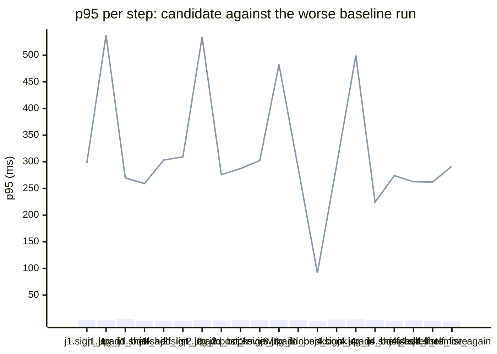

### Downstream report

Candidate `11ae5361` against baseline `0fa756eb`. Run started 2026-10-22T23:30:02Z, ended 2026-10-22T23:30:19Z. 2 VUs, 10 iterations per VU per pass (cap 60 s), k6 v0.56.0 (commit/50afb99947, go1.23.4, linux/amd64).

**Findings:** regressed steps 22, trade-off journeys 0, improved metrics 0, withheld metrics 0. App process regressions: 1.

#### A new reader signs up, logs in, adds a book and puts it on their shelf

| Step | Baseline p95 (B1 / B2) | Candidate p95 | Change | Noise band | Verdict |
|---|---|---|---|---|---|
| `sign_up` | 3.5 / 1.6 ms | 297.6 ms | +294.1 ms (+8352%) | 1.9 ms | regression |
| `log_in` | 2.8 / 1.6 ms | 537.9 ms | +535.1 ms (+19422%) | 1.1 ms | regression |
| `add_book` | 5.2 / 1.2 ms | 269.9 ms | +264.7 ms (+5081%) | 4.1 ms | regression |
| `shelf_add` | 2.0 / 0.7 ms | 259.1 ms | +257.1 ms (+12632%) | 1.3 ms | regression |
| `shelf_list` | 2.0 / 1.0 ms | 303.4 ms | +301.4 ms (+15293%) | 1.0 ms | regression |

#### A reader logs in, reviews a book and reads the reviews

| Step | Baseline p95 (B1 / B2) | Candidate p95 | Change | Noise band | Verdict |
|---|---|---|---|---|---|
| `sign_up` | 1.6 / 2.1 ms | 309.1 ms | +307.0 ms (+14497%) | 0.6 ms | regression |
| `log_in` | 2.8 / 3.7 ms | 534.1 ms | +530.4 ms (+14521%) | 0.9 ms | regression |
| `add_book` | 1.4 / 2.3 ms | 275.8 ms | +273.5 ms (+11909%) | 0.9 ms | regression |
| `post_review` | 1.1 / 2.9 ms | 287.4 ms | +284.5 ms (+9710%) | 1.8 ms | regression |
| `read_reviews` | 2.0 / 2.4 ms | 75.1 ms | +72.7 ms (+3017%) | 0.4 ms | regression |

#### A visitor browses books by tag and opens one

| Step | Baseline p95 (B1 / B2) | Candidate p95 | Change | Noise band | Verdict |
|---|---|---|---|---|---|
| `sign_up` | 2.6 / 3.4 ms | 302.4 ms | +299.1 ms (+8821%) | 0.7 ms | regression |
| `log_in` | 3.3 / 3.0 ms | 482.4 ms | +479.1 ms (+14333%) | 0.3 ms | regression |
| `add_book` | 2.7 / 2.6 ms | 288.2 ms | +285.5 ms (+10436%) | 0.2 ms | regression |
| `browse_tag` | 2.4 / 1.5 ms | 74.5 ms | +72.1 ms (+2945%) | 0.9 ms | regression |
| `open_book` | 0.8 / 1.1 ms | 91.3 ms | +90.2 ms (+8332%) | 0.3 ms | regression |

#### A reader views their shelf and removes a book

| Step | Baseline p95 (B1 / B2) | Candidate p95 | Change | Noise band | Verdict |
|---|---|---|---|---|---|
| `sign_up` | 3.6 / 4.2 ms | 293.6 ms | +289.3 ms (+6859%) | 0.6 ms | regression |
| `log_in` | 4.4 / 2.8 ms | 499.4 ms | +495.1 ms (+11284%) | 1.6 ms | regression |
| `add_book` | 3.6 / 2.3 ms | 224.2 ms | +220.6 ms (+6184%) | 1.3 ms | regression |
| `shelf_add` | 1.7 / 2.1 ms | 274.1 ms | +272.0 ms (+12901%) | 0.4 ms | regression |
| `shelf_list` | 2.4 / 2.2 ms | 262.7 ms | +260.4 ms (+10873%) | 0.2 ms | regression |
| `shelf_remove` | 1.5 / 2.0 ms | 262.0 ms | +260.0 ms (+13057%) | 0.5 ms | regression |
| `shelf_list_again` | 0.8 / 0.9 ms | 292.0 ms | +291.1 ms (+32149%) | 0.1 ms | regression |

**App process**

| Metric | B1 | C | B2 | Change | Noise band | Verdict |
|---|---|---|---|---|---|---|
| CPU time | 0.16 s | 27.10 s | 0.16 s | +26.94 s (+16838%) | 0.00 s | regression |
| Peak RSS | 8.9 MB | 8.9 MB | 8.6 MB | +0.1 MB (+1%) | 0.2 MB | noise |

**p95 per step**

Bars: worse of the two baseline runs. Line: candidate.
The chart shows the 20 steps with the largest change, out of 22.

- j1: A new reader signs up, logs in, adds a book and puts it on their shelf
- j2: A reader logs in, reviews a book and reads the reviews
- j3: A visitor browses books by tag and opens one
- j4: A reader views their shelf and removes a book

**Issues to open**

- `new_reader_builds_shelf.log_in.p95_ms` (19 steps)
- `visitor_browses_by_tag.open_book.p95_ms` (3 steps)

22 regressed steps are grouped into 2 by the changed functions on the routes they call; one issue per group.

**Discarded journeys**

none

**Blast radius**

Changed routes:

- `POST /users`: handler (Server).handleCreateUser calls changed function hashSecret (depth 2)
- `POST /login`: handler (Server).handleLogin calls changed function hashSecret (depth 2)
- `POST /books`: middleware (Server).requireAuth reaches changed function hashSecret (depth 2): every request on this route runs it
- `POST /books/{id}/reviews`: middleware (Server).requireAuth reaches changed function hashSecret (depth 2): every request on this route runs it
- `PUT /me/shelf/{id}`: middleware (Server).requireAuth reaches changed function hashSecret (depth 2): every request on this route runs it
- `GET /me/shelf`: middleware (Server).requireAuth reaches changed function hashSecret (depth 2): every request on this route runs it
- `DELETE /me/shelf/{id}`: middleware (Server).requireAuth reaches changed function hashSecret (depth 2): every request on this route runs it

Affected routes:

- `GET /books`: shares function hasTag with changed route PUT /me/shelf/{id}

*static analysis with go/ast, calls resolved by name, depth 2 from handlers and middleware, a function reached by more than half of all routes is ignored when looking for shared functions; misses dynamic registration, reflection, interface dispatch by other names, and cross-service calls*

**Not measured**

- DB time: not measured; the target exposes no database timing.

**Method.** Baseline run twice (B1, B2) and candidate once (C), in the order B1, C, B2, sequentially on one machine. Three runs give no confidence interval; treat verdicts near the thresholds as uncertain.

Thresholds in effect: a metric is a regression when the candidate is worse than the worse baseline run by more than 2 times the noise band (the difference between B1 and B2), by at least 20%, and by at least 10 ms (latency), 10 MB (memory) or 0.5 s (CPU). A step that passed on both baseline runs and failed on the candidate is a regression. The verdict is withheld when the baseline runs differ by more than 50% of the smaller one and by at least the same minimum, unless the candidate is clearly worse or better than both. A journey with a latency regression and a latency improvement is reported as a trade-off.
