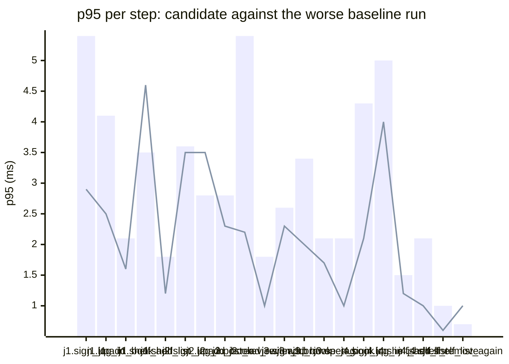

### Downstream report

Candidate `cddbd558` against baseline `baacc58f`. Run started 2026-10-23T03:50:33Z, ended 2026-10-23T03:50:36Z. 2 VUs, 10 iterations per VU per pass (cap 60 s), k6 v0.56.0 (commit/50afb99947, go1.23.4, linux/amd64).

**Findings:** regressed steps 0, trade-off journeys 0, improved metrics 0, withheld metrics 0.

#### A new reader signs up, logs in, adds a book and puts it on their shelf

| Step | Baseline p95 (B1 / B2) | Candidate p95 | Change | Noise band | Verdict |
|---|---|---|---|---|---|
| `sign_up` | 5.4 / 3.0 ms | 2.9 ms | -2.5 ms (-47%) | 2.4 ms | noise |
| `log_in` | 4.1 / 2.4 ms | 2.5 ms | -1.5 ms (-38%) | 1.7 ms | noise |
| `add_book` | 2.1 / 1.9 ms | 1.6 ms | -0.4 ms (-21%) | 0.2 ms | noise |
| `shelf_add` | 3.5 / 1.5 ms | 4.6 ms | +1.1 ms (+32%) | 2.0 ms | noise |
| `shelf_list` | 1.6 / 1.8 ms | 1.2 ms | -0.6 ms (-33%) | 0.3 ms | noise |

#### A reader logs in, reviews a book and reads the reviews

| Step | Baseline p95 (B1 / B2) | Candidate p95 | Change | Noise band | Verdict |
|---|---|---|---|---|---|
| `sign_up` | 3.6 / 2.5 ms | 3.5 ms | -0.1 ms (-1%) | 1.1 ms | noise |
| `log_in` | 2.7 / 2.8 ms | 3.5 ms | +0.7 ms (+23%) | 0.2 ms | noise |
| `add_book` | 2.2 / 2.8 ms | 2.3 ms | -0.5 ms (-19%) | 0.7 ms | noise |
| `post_review` | 2.9 / 5.4 ms | 2.2 ms | -3.2 ms (-59%) | 2.5 ms | noise |
| `read_reviews` | 1.8 / 1.2 ms | 1.0 ms | -0.8 ms (-45%) | 0.6 ms | noise |

#### A visitor browses books by tag and opens one

| Step | Baseline p95 (B1 / B2) | Candidate p95 | Change | Noise band | Verdict |
|---|---|---|---|---|---|
| `sign_up` | 2.6 / 2.3 ms | 2.3 ms | -0.2 ms (-9%) | 0.3 ms | noise |
| `log_in` | 2.6 / 5.8 ms | 2.0 ms | -3.7 ms (-65%) | 3.2 ms | noise |
| `add_book` | 3.4 / 2.7 ms | 2.0 ms | -1.4 ms (-40%) | 0.7 ms | noise |
| `browse_tag` | 2.1 / 1.9 ms | 1.7 ms | -0.4 ms (-19%) | 0.1 ms | noise |
| `open_book` | 1.4 / 2.1 ms | 1.0 ms | -1.1 ms (-54%) | 0.7 ms | noise |

#### A reader views their shelf and removes a book

| Step | Baseline p95 (B1 / B2) | Candidate p95 | Change | Noise band | Verdict |
|---|---|---|---|---|---|
| `sign_up` | 2.1 / 4.3 ms | 2.1 ms | -2.2 ms (-51%) | 2.3 ms | noise |
| `log_in` | 2.8 / 5.0 ms | 4.0 ms | -0.9 ms (-19%) | 2.2 ms | noise |
| `add_book` | 2.2 / 4.5 ms | 1.1 ms | -3.4 ms (-76%) | 2.3 ms | noise |
| `shelf_add` | 1.5 / 1.3 ms | 1.2 ms | -0.3 ms (-20%) | 0.2 ms | noise |
| `shelf_list` | 2.1 / 0.7 ms | 1.0 ms | -1.1 ms (-52%) | 1.4 ms | noise |
| `shelf_remove` | 0.9 / 1.0 ms | 0.6 ms | -0.4 ms (-38%) | 0.1 ms | noise |
| `shelf_list_again` | 0.7 / 0.7 ms | 1.0 ms | +0.3 ms (+37%) | 0.0 ms | noise |

**App process**

| Metric | B1 | C | B2 | Change | Noise band | Verdict |
|---|---|---|---|---|---|---|
| CPU time | 0.17 s | 0.17 s | 0.17 s | +0.00 s (+0%) | 0.00 s | noise |
| Peak RSS | 8.5 MB | 8.9 MB | 8.8 MB | +0.2 MB (+2%) | 0.3 MB | noise |

**p95 per step**

Bars: worse of the two baseline runs. Line: candidate.
The chart shows the 20 steps with the largest change, out of 22.

- j1: A new reader signs up, logs in, adds a book and puts it on their shelf
- j2: A reader logs in, reviews a book and reads the reviews
- j3: A visitor browses books by tag and opens one
- j4: A reader views their shelf and removes a book

**Issues to open**

none

**Discarded journeys**

none

**Blast radius**

Changed routes:

- `GET /health`: handler (Server).handleHealth itself changed

Affected routes:

- none

*static analysis with go/ast, calls resolved by name, depth 2 from handlers and middleware, a function reached by more than half of all routes is ignored when looking for shared functions; misses dynamic registration, reflection, interface dispatch by other names, and cross-service calls*

**Not measured**

- DB time: not measured; the target exposes no database timing.

**Method.** Baseline run twice (B1, B2) and candidate once (C), in the order B1, C, B2, sequentially on one machine. Three runs give no confidence interval; treat verdicts near the thresholds as uncertain.

Thresholds in effect: a metric is a regression when the candidate is worse than the worse baseline run by more than 2 times the noise band (the difference between B1 and B2), by at least 20%, and by at least 10 ms (latency), 10 MB (memory) or 0.5 s (CPU). A step that passed on both baseline runs and failed on the candidate is a regression. The verdict is withheld when the baseline runs differ by more than 50% of the smaller one and by at least the same minimum, unless the candidate is clearly worse or better than both. A journey with a latency regression and a latency improvement is reported as a trade-off.
