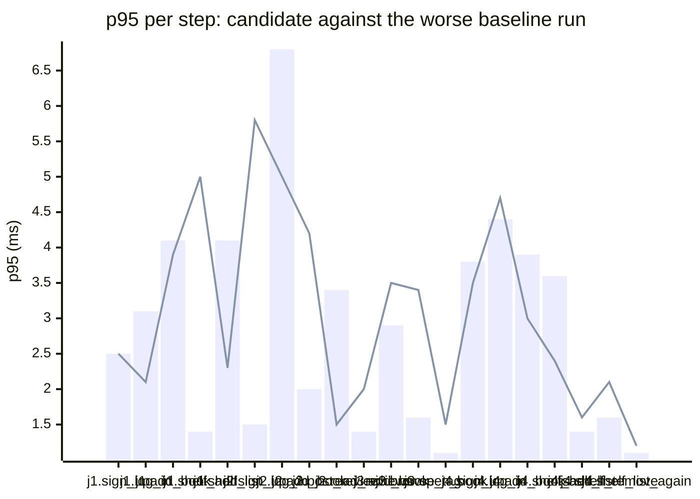

### Downstream report

Candidate `aadf1e2e` against baseline `baacc58f`. Run started 2026-10-23T03:50:30Z, ended 2026-10-23T03:50:33Z. 2 VUs, 10 iterations per VU per pass (cap 60 s), k6 v0.56.0 (commit/50afb99947, go1.23.4, linux/amd64).

**Findings:** regressed steps 0, trade-off journeys 0, improved metrics 0, withheld metrics 0.

#### A new reader signs up, logs in, adds a book and puts it on their shelf

| Step | Baseline p95 (B1 / B2) | Candidate p95 | Change | Noise band | Verdict |
|---|---|---|---|---|---|
| `sign_up` | 1.0 / 2.5 ms | 2.5 ms | -0.1 ms (-3%) | 1.5 ms | noise |
| `log_in` | 1.2 / 3.1 ms | 2.1 ms | -1.1 ms (-34%) | 2.0 ms | noise |
| `add_book` | 0.7 / 4.1 ms | 3.9 ms | -0.2 ms (-4%) | 3.5 ms | noise |
| `shelf_add` | 0.5 / 1.4 ms | 5.0 ms | +3.7 ms (+264%) | 0.9 ms | noise |
| `shelf_list` | 1.0 / 4.1 ms | 2.3 ms | -1.8 ms (-45%) | 3.2 ms | noise |

#### A reader logs in, reviews a book and reads the reviews

| Step | Baseline p95 (B1 / B2) | Candidate p95 | Change | Noise band | Verdict |
|---|---|---|---|---|---|
| `sign_up` | 1.5 / 1.4 ms | 5.8 ms | +4.3 ms (+281%) | 0.1 ms | noise |
| `log_in` | 6.8 / 3.0 ms | 5.0 ms | -1.8 ms (-26%) | 3.8 ms | noise |
| `add_book` | 1.0 / 2.0 ms | 4.2 ms | +2.2 ms (+112%) | 1.0 ms | noise |
| `post_review` | 2.0 / 3.4 ms | 1.5 ms | -1.9 ms (-56%) | 1.4 ms | noise |
| `read_reviews` | 0.5 / 1.4 ms | 2.0 ms | +0.5 ms (+36%) | 1.0 ms | noise |

#### A visitor browses books by tag and opens one

| Step | Baseline p95 (B1 / B2) | Candidate p95 | Change | Noise band | Verdict |
|---|---|---|---|---|---|
| `sign_up` | 4.4 / 2.5 ms | 2.0 ms | -2.4 ms (-54%) | 1.8 ms | noise |
| `log_in` | 1.3 / 7.6 ms | 2.8 ms | -4.8 ms (-64%) | 6.3 ms | noise |
| `add_book` | 1.7 / 2.9 ms | 3.5 ms | +0.6 ms (+19%) | 1.2 ms | noise |
| `browse_tag` | 1.3 / 1.6 ms | 3.4 ms | +1.8 ms (+113%) | 0.3 ms | noise |
| `open_book` | 1.1 / 1.0 ms | 1.5 ms | +0.4 ms (+36%) | 0.1 ms | noise |

#### A reader views their shelf and removes a book

| Step | Baseline p95 (B1 / B2) | Candidate p95 | Change | Noise band | Verdict |
|---|---|---|---|---|---|
| `sign_up` | 2.9 / 3.8 ms | 3.5 ms | -0.3 ms (-8%) | 0.9 ms | noise |
| `log_in` | 4.4 / 3.4 ms | 4.7 ms | +0.3 ms (+7%) | 1.1 ms | noise |
| `add_book` | 1.6 / 3.9 ms | 3.0 ms | -0.9 ms (-23%) | 2.4 ms | noise |
| `shelf_add` | 2.3 / 3.6 ms | 2.4 ms | -1.2 ms (-34%) | 1.4 ms | noise |
| `shelf_list` | 1.4 / 1.1 ms | 1.6 ms | +0.3 ms (+19%) | 0.3 ms | noise |
| `shelf_remove` | 0.9 / 1.6 ms | 2.1 ms | +0.5 ms (+28%) | 0.8 ms | noise |
| `shelf_list_again` | 1.1 / 0.8 ms | 1.2 ms | +0.1 ms (+10%) | 0.3 ms | noise |

**App process**

| Metric | B1 | C | B2 | Change | Noise band | Verdict |
|---|---|---|---|---|---|---|
| CPU time | 0.16 s | 0.17 s | 0.16 s | +0.01 s (+6%) | 0.00 s | noise |
| Peak RSS | 9.0 MB | 8.5 MB | 8.6 MB | -0.4 MB (-5%) | 0.4 MB | noise |

**p95 per step**

Bars: worse of the two baseline runs. Line: candidate.
The chart shows the 20 steps with the largest change, out of 22.

- j1: A new reader signs up, logs in, adds a book and puts it on their shelf
- j2: A reader logs in, reviews a book and reads the reviews
- j3: A visitor browses books by tag and opens one
- j4: A reader views their shelf and removes a book

**Issues to open**

none

**Discarded journeys**

none

**Blast radius**

Changed routes:

- `GET /health`: handler (Server).handleHealth itself changed

Affected routes:

- none

*static analysis with go/ast, calls resolved by name, depth 2 from handlers and middleware, a function reached by more than half of all routes is ignored when looking for shared functions; misses dynamic registration, reflection, interface dispatch by other names, and cross-service calls*

**Not measured**

- DB time: not measured; the target exposes no database timing.

**Method.** Baseline run twice (B1, B2) and candidate once (C), in the order B1, C, B2, sequentially on one machine. Three runs give no confidence interval; treat verdicts near the thresholds as uncertain.

Thresholds in effect: a metric is a regression when the candidate is worse than the worse baseline run by more than 2 times the noise band (the difference between B1 and B2), by at least 20%, and by at least 10 ms (latency), 10 MB (memory) or 0.5 s (CPU). A step that passed on both baseline runs and failed on the candidate is a regression. The verdict is withheld when the baseline runs differ by more than 50% of the smaller one and by at least the same minimum, unless the candidate is clearly worse or better than both. A journey with a latency regression and a latency improvement is reported as a trade-off.
