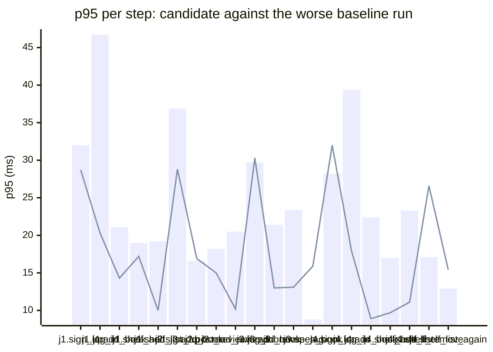

### Downstream report

Candidate `c200eb6f` against baseline `0fa756eb`. Run started 2026-10-23T03:46:02Z, ended 2026-10-23T03:46:13Z. 2 VUs, 10 iterations per VU per pass (cap 60 s), k6 v0.56.0 (commit/50afb99947, go1.23.4, linux/amd64).

**Findings:** regressed steps 0, trade-off journeys 0, improved metrics 1, withheld metrics 6.

#### A new reader signs up, logs in, adds a book and puts it on their shelf

| Step | Baseline p95 (B1 / B2) | Candidate p95 | Change | Noise band | Verdict |
|---|---|---|---|---|---|
| `sign_up` | 13.7 / 32.0 ms | 28.7 ms | -3.3 ms (-10%) | 18.2 ms | withheld |
| `log_in` | 21.3 / 46.7 ms | 20.3 ms | -26.4 ms (-56%) | 25.4 ms | withheld |
| `add_book` | 21.1 / 20.4 ms | 14.3 ms | -6.9 ms (-33%) | 0.8 ms | noise |
| `shelf_add` | 19.0 / 16.6 ms | 17.2 ms | -1.8 ms (-9%) | 2.4 ms | noise |
| `shelf_list` | 19.2 / 16.9 ms | 10.0 ms | -9.1 ms (-48%) | 2.3 ms | noise |

#### A reader logs in, reviews a book and reads the reviews

| Step | Baseline p95 (B1 / B2) | Candidate p95 | Change | Noise band | Verdict |
|---|---|---|---|---|---|
| `sign_up` | 16.9 / 36.9 ms | 28.8 ms | -8.0 ms (-22%) | 20.0 ms | withheld |
| `log_in` | 28.9 / 81.2 ms | 20.3 ms | -60.9 ms (-75%) | 52.3 ms | withheld |
| `add_book` | 16.6 / 15.2 ms | 16.9 ms | +0.4 ms (+2%) | 1.4 ms | noise |
| `post_review` | 18.2 / 15.2 ms | 15.0 ms | -3.1 ms (-17%) | 3.0 ms | noise |
| `read_reviews` | 13.6 / 20.5 ms | 10.2 ms | -10.3 ms (-50%) | 6.9 ms | noise |

#### A visitor browses books by tag and opens one

| Step | Baseline p95 (B1 / B2) | Candidate p95 | Change | Noise band | Verdict |
|---|---|---|---|---|---|
| `sign_up` | 20.6 / 46.9 ms | 16.0 ms | -30.9 ms (-66%) | 26.3 ms | withheld |
| `log_in` | 29.7 / 25.8 ms | 30.3 ms | +0.6 ms (+2%) | 3.9 ms | noise |
| `add_book` | 19.2 / 21.4 ms | 13.0 ms | -8.3 ms (-39%) | 2.2 ms | noise |
| `browse_tag` | 19.8 / 23.4 ms | 13.1 ms | -10.2 ms (-44%) | 3.5 ms | noise |
| `open_book` | 8.8 / 7.4 ms | 15.9 ms | +7.1 ms (+81%) | 1.4 ms | noise |

#### A reader views their shelf and removes a book

| Step | Baseline p95 (B1 / B2) | Candidate p95 | Change | Noise band | Verdict |
|---|---|---|---|---|---|
| `sign_up` | 28.2 / 28.2 ms | 32.0 ms | +3.8 ms (+13%) | 0.0 ms | noise |
| `log_in` | 18.2 / 39.4 ms | 17.9 ms | -21.5 ms (-55%) | 21.2 ms | withheld |
| `add_book` | 16.7 / 22.4 ms | 8.9 ms | -13.5 ms (-60%) | 5.7 ms | noise |
| `shelf_add` | 17.0 / 13.0 ms | 9.7 ms | -7.3 ms (-43%) | 3.9 ms | noise |
| `shelf_list` | 22.8 / 23.3 ms | 11.1 ms | -12.2 ms (-52%) | 0.5 ms | improved |
| `shelf_remove` | 12.9 / 17.1 ms | 26.6 ms | +9.5 ms (+56%) | 4.2 ms | noise |
| `shelf_list_again` | 5.8 / 12.9 ms | 15.4 ms | +2.6 ms (+20%) | 7.1 ms | noise |

**App process**

| Metric | B1 | C | B2 | Change | Noise band | Verdict |
|---|---|---|---|---|---|---|
| CPU time | 1.11 s | 1.15 s | 1.14 s | +0.01 s (+1%) | 0.03 s | noise |
| Peak RSS | 8.1 MB | 8.2 MB | 8.1 MB | +0.1 MB (+2%) | 0.0 MB | noise |

**p95 per step**

Bars: worse of the two baseline runs. Line: candidate.
The chart shows the 20 steps with the largest change, out of 22.

- j1: A new reader signs up, logs in, adds a book and puts it on their shelf
- j2: A reader logs in, reviews a book and reads the reviews
- j3: A visitor browses books by tag and opens one
- j4: A reader views their shelf and removes a book

**Issues to open**

none

**Discarded journeys**

none

**Blast radius**

Changed routes:

- `GET /health`: handler (Server).handleHealth itself changed

Affected routes:

- none

*static analysis with go/ast, calls resolved by name, depth 2 from handlers and middleware, a function reached by more than half of all routes is ignored when looking for shared functions; misses dynamic registration, reflection, interface dispatch by other names, and cross-service calls*

**Not measured**

- DB time: not measured; the target exposes no database timing.

**Method.** Baseline run twice (B1, B2) and candidate once (C), in the order B1, C, B2, sequentially on one machine. Three runs give no confidence interval; treat verdicts near the thresholds as uncertain.

Thresholds in effect: a metric is a regression when the candidate is worse than the worse baseline run by more than 2 times the noise band (the difference between B1 and B2), by at least 20%, and by at least 10 ms (latency), 10 MB (memory) or 0.5 s (CPU). A step that passed on both baseline runs and failed on the candidate is a regression. The verdict is withheld when the baseline runs differ by more than 50% of the smaller one and by at least the same minimum, unless the candidate is clearly worse or better than both. A journey with a latency regression and a latency improvement is reported as a trade-off.
