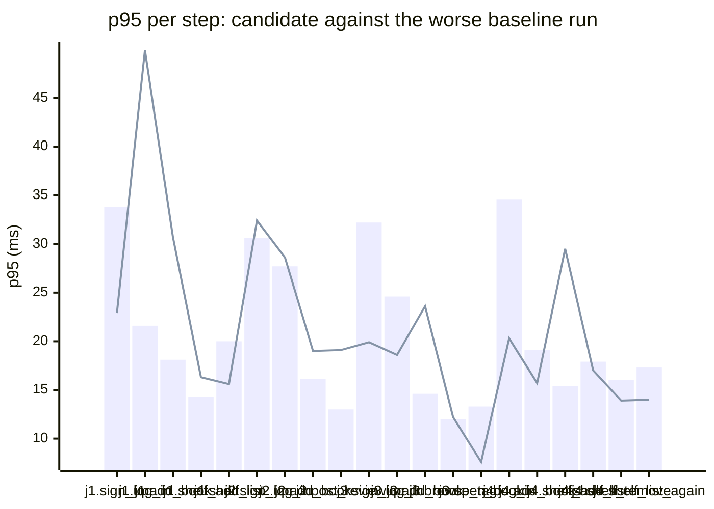

### Downstream report

Candidate `c200eb6f` against baseline `0fa756eb`. Run started 2026-10-23T03:46:13Z, ended 2026-10-23T03:46:24Z. 2 VUs, 10 iterations per VU per pass (cap 60 s), k6 v0.56.0 (commit/50afb99947, go1.23.4, linux/amd64).

**Findings:** regressed steps 3, trade-off journeys 0, improved metrics 0, withheld metrics 7.

#### A new reader signs up, logs in, adds a book and puts it on their shelf

| Step | Baseline p95 (B1 / B2) | Candidate p95 | Change | Noise band | Verdict |
|---|---|---|---|---|---|
| `sign_up` | 33.8 / 18.1 ms | 22.9 ms | -10.9 ms (-32%) | 15.7 ms | withheld |
| `log_in` | 21.4 / 21.6 ms | 49.9 ms | +28.3 ms (+131%) | 0.2 ms | regression |
| `add_book` | 18.1 / 12.9 ms | 30.7 ms | +12.6 ms (+70%) | 5.2 ms | regression |
| `shelf_add` | 14.3 / 11.4 ms | 16.3 ms | +2.0 ms (+14%) | 2.9 ms | noise |
| `shelf_list` | 20.0 / 9.5 ms | 15.6 ms | -4.5 ms (-22%) | 10.6 ms | withheld |

#### A reader logs in, reviews a book and reads the reviews

| Step | Baseline p95 (B1 / B2) | Candidate p95 | Change | Noise band | Verdict |
|---|---|---|---|---|---|
| `sign_up` | 30.6 / 20.2 ms | 32.4 ms | +1.7 ms (+6%) | 10.4 ms | withheld |
| `log_in` | 27.7 / 22.2 ms | 28.6 ms | +0.9 ms (+3%) | 5.5 ms | noise |
| `add_book` | 13.3 / 16.1 ms | 19.0 ms | +2.8 ms (+18%) | 2.8 ms | noise |
| `post_review` | 13.0 / 12.7 ms | 19.1 ms | +6.1 ms (+47%) | 0.2 ms | noise |
| `read_reviews` | 29.6 / 4.1 ms | 10.8 ms | -18.8 ms (-63%) | 25.5 ms | withheld |

#### A visitor browses books by tag and opens one

| Step | Baseline p95 (B1 / B2) | Candidate p95 | Change | Noise band | Verdict |
|---|---|---|---|---|---|
| `sign_up` | 32.2 / 14.8 ms | 19.9 ms | -12.3 ms (-38%) | 17.4 ms | withheld |
| `log_in` | 21.7 / 24.6 ms | 18.6 ms | -6.0 ms (-24%) | 3.0 ms | noise |
| `add_book` | 14.6 / 11.9 ms | 23.6 ms | +8.9 ms (+61%) | 2.7 ms | noise |
| `browse_tag` | 12.0 / 4.0 ms | 12.2 ms | +0.2 ms (+2%) | 8.0 ms | noise |
| `open_book` | 13.3 / 9.4 ms | 7.6 ms | -5.7 ms (-43%) | 3.9 ms | noise |

#### A reader views their shelf and removes a book

| Step | Baseline p95 (B1 / B2) | Candidate p95 | Change | Noise band | Verdict |
|---|---|---|---|---|---|
| `sign_up` | 29.8 / 15.5 ms | 14.7 ms | -15.1 ms (-51%) | 14.3 ms | withheld |
| `log_in` | 34.6 / 24.4 ms | 20.3 ms | -14.3 ms (-41%) | 10.3 ms | noise |
| `add_book` | 17.1 / 19.1 ms | 15.7 ms | -3.4 ms (-18%) | 2.0 ms | noise |
| `shelf_add` | 15.4 / 11.1 ms | 29.5 ms | +14.1 ms (+92%) | 4.2 ms | regression |
| `shelf_list` | 17.9 / 12.1 ms | 17.0 ms | -0.9 ms (-5%) | 5.8 ms | noise |
| `shelf_remove` | 16.0 / 9.4 ms | 13.9 ms | -2.2 ms (-13%) | 6.6 ms | noise |
| `shelf_list_again` | 17.3 / 7.1 ms | 14.0 ms | -3.3 ms (-19%) | 10.3 ms | withheld |

**App process**

| Metric | B1 | C | B2 | Change | Noise band | Verdict |
|---|---|---|---|---|---|---|
| CPU time | 1.56 s | 1.39 s | 1.07 s | -0.17 s (-11%) | 0.49 s | noise |
| Peak RSS | 8.1 MB | 8.1 MB | 8.4 MB | -0.2 MB (-3%) | 0.2 MB | noise |

**p95 per step**

Bars: worse of the two baseline runs. Line: candidate.
The chart shows the 20 steps with the largest change, out of 22.

- j1: A new reader signs up, logs in, adds a book and puts it on their shelf
- j2: A reader logs in, reviews a book and reads the reviews
- j3: A visitor browses books by tag and opens one
- j4: A reader views their shelf and removes a book

**Issues to open**

- `new_reader_builds_shelf.log_in.p95_ms` (3 steps)

3 regressed steps are grouped into 1 by the changed functions on the routes they call; one issue per group.

**Discarded journeys**

none

**Blast radius**

Changed routes:

- `GET /health`: handler (Server).handleHealth itself changed

Affected routes:

- none

*static analysis with go/ast, calls resolved by name, depth 2 from handlers and middleware, a function reached by more than half of all routes is ignored when looking for shared functions; misses dynamic registration, reflection, interface dispatch by other names, and cross-service calls*

**Not measured**

- DB time: not measured; the target exposes no database timing.

**Method.** Baseline run twice (B1, B2) and candidate once (C), in the order B1, C, B2, sequentially on one machine. Three runs give no confidence interval; treat verdicts near the thresholds as uncertain.

Thresholds in effect: a metric is a regression when the candidate is worse than the worse baseline run by more than 2 times the noise band (the difference between B1 and B2), by at least 20%, and by at least 10 ms (latency), 10 MB (memory) or 0.5 s (CPU). A step that passed on both baseline runs and failed on the candidate is a regression. The verdict is withheld when the baseline runs differ by more than 50% of the smaller one and by at least the same minimum, unless the candidate is clearly worse or better than both. A journey with a latency regression and a latency improvement is reported as a trade-off.
