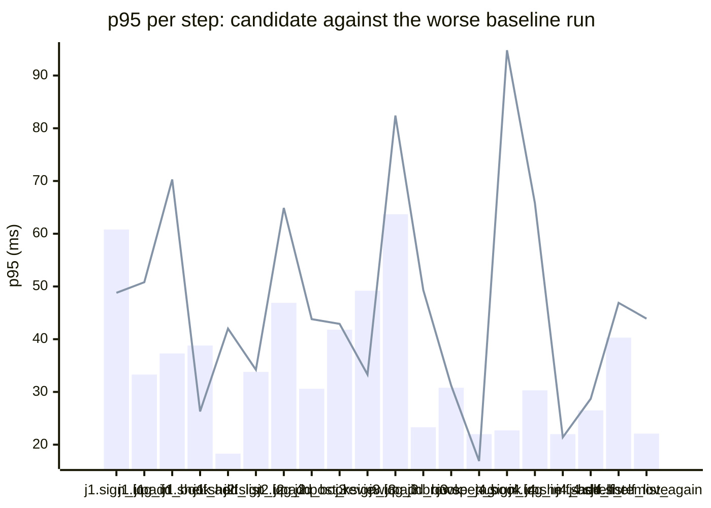

### Downstream report

Candidate `c200eb6f` against baseline `0fa756eb`. Run started 2026-10-23T03:46:25Z, ended 2026-10-23T03:46:35Z. 2 VUs, 10 iterations per VU per pass (cap 60 s), k6 v0.56.0 (commit/50afb99947, go1.23.4, linux/amd64).

**Findings:** regressed steps 7, trade-off journeys 0, improved metrics 0, withheld metrics 22.

#### A new reader signs up, logs in, adds a book and puts it on their shelf

| Step | Baseline p95 (B1 / B2) | Candidate p95 | Change | Noise band | Verdict |
|---|---|---|---|---|---|
| `sign_up` | 60.8 / 13.7 ms | 48.8 ms | -12.0 ms (-20%) | 47.1 ms | withheld |
| `log_in` | 33.3 / 28.3 ms | 50.8 ms | +17.5 ms (+53%) | 5.0 ms | regression |
| `log_in` (p50) | 16.1 / 4.1 ms | 20.2 ms | +4.1 ms (+26%) | 12.0 ms | withheld |
| `add_book` | 37.3 / 19.0 ms | 70.3 ms | +33.0 ms (+88%) | 18.3 ms | withheld |
| `shelf_add` | 38.8 / 13.4 ms | 26.3 ms | -12.5 ms (-32%) | 25.5 ms | withheld |
| `shelf_list` | 18.3 / 11.5 ms | 42.0 ms | +23.7 ms (+129%) | 6.8 ms | regression |

#### A reader logs in, reviews a book and reads the reviews

| Step | Baseline p95 (B1 / B2) | Candidate p95 | Change | Noise band | Verdict |
|---|---|---|---|---|---|
| `sign_up` | 33.8 / 23.2 ms | 34.2 ms | +0.4 ms (+1%) | 10.6 ms | noise |
| `log_in` | 46.9 / 22.7 ms | 64.9 ms | +17.9 ms (+38%) | 24.3 ms | withheld |
| `add_book` | 30.6 / 17.5 ms | 43.8 ms | +13.1 ms (+43%) | 13.2 ms | withheld |
| `post_review` | 41.8 / 14.6 ms | 42.9 ms | +1.1 ms (+3%) | 27.1 ms | withheld |
| `read_reviews` | 57.0 / 7.6 ms | 21.8 ms | -35.3 ms (-62%) | 49.5 ms | withheld |
| `read_reviews` (p50) | 1.6 / 0.8 ms | 13.4 ms | +11.8 ms (+714%) | 0.8 ms | regression |

#### A visitor browses books by tag and opens one

| Step | Baseline p95 (B1 / B2) | Candidate p95 | Change | Noise band | Verdict |
|---|---|---|---|---|---|
| `sign_up` | 49.2 / 17.2 ms | 33.3 ms | -15.9 ms (-32%) | 32.0 ms | withheld |
| `log_in` | 63.7 / 21.6 ms | 82.4 ms | +18.7 ms (+29%) | 42.1 ms | withheld |
| `add_book` | 23.3 / 14.2 ms | 49.3 ms | +26.0 ms (+112%) | 9.1 ms | regression |
| `browse_tag` | 30.8 / 8.2 ms | 31.2 ms | +0.4 ms (+1%) | 22.5 ms | withheld |
| `open_book` | 22.0 / 9.8 ms | 16.9 ms | -5.2 ms (-23%) | 12.2 ms | withheld |

#### A reader views their shelf and removes a book

| Step | Baseline p95 (B1 / B2) | Candidate p95 | Change | Noise band | Verdict |
|---|---|---|---|---|---|
| `sign_up` | 18.1 / 22.7 ms | 94.8 ms | +72.1 ms (+317%) | 4.6 ms | regression |
| `log_in` | 30.3 / 24.3 ms | 65.8 ms | +35.5 ms (+117%) | 6.0 ms | regression |
| `add_book` | 74.8 / 15.4 ms | 33.8 ms | -41.0 ms (-55%) | 59.3 ms | withheld |
| `shelf_add` | 22.0 / 12.1 ms | 21.4 ms | -0.6 ms (-3%) | 9.9 ms | noise |
| `shelf_list` | 26.5 / 7.8 ms | 28.7 ms | +2.2 ms (+8%) | 18.7 ms | withheld |
| `shelf_remove` | 40.3 / 10.6 ms | 46.9 ms | +6.6 ms (+16%) | 29.7 ms | withheld |
| `shelf_list_again` | 22.1 / 14.2 ms | 43.9 ms | +21.9 ms (+99%) | 7.9 ms | regression |

**App process**

| Metric | B1 | C | B2 | Change | Noise band | Verdict |
|---|---|---|---|---|---|---|
| CPU time | 1.54 s | 1.75 s | 0.94 s | +0.21 s (+14%) | 0.60 s | withheld |
| Peak RSS | 8.2 MB | 8.2 MB | 8.1 MB | +0.0 MB (+0%) | 0.1 MB | noise |

**p95 per step**

Bars: worse of the two baseline runs. Line: candidate.
The chart shows the 20 steps with the largest change, out of 22.

- j1: A new reader signs up, logs in, adds a book and puts it on their shelf
- j2: A reader logs in, reviews a book and reads the reviews
- j3: A visitor browses books by tag and opens one
- j4: A reader views their shelf and removes a book

**Issues to open**

- `reader_tidies_shelf.sign_up.p95_ms` (7 steps)

7 regressed steps are grouped into 1 by the changed functions on the routes they call; one issue per group.

**Discarded journeys**

none

**Blast radius**

Changed routes:

- `GET /health`: handler (Server).handleHealth itself changed

Affected routes:

- none

*static analysis with go/ast, calls resolved by name, depth 2 from handlers and middleware, a function reached by more than half of all routes is ignored when looking for shared functions; misses dynamic registration, reflection, interface dispatch by other names, and cross-service calls*

**Not measured**

- DB time: not measured; the target exposes no database timing.

**Method.** Baseline run twice (B1, B2) and candidate once (C), in the order B1, C, B2, sequentially on one machine. Three runs give no confidence interval; treat verdicts near the thresholds as uncertain.

Thresholds in effect: a metric is a regression when the candidate is worse than the worse baseline run by more than 2 times the noise band (the difference between B1 and B2), by at least 20%, and by at least 10 ms (latency), 10 MB (memory) or 0.5 s (CPU). A step that passed on both baseline runs and failed on the candidate is a regression. The verdict is withheld when the baseline runs differ by more than 50% of the smaller one and by at least the same minimum, unless the candidate is clearly worse or better than both. A journey with a latency regression and a latency improvement is reported as a trade-off.
