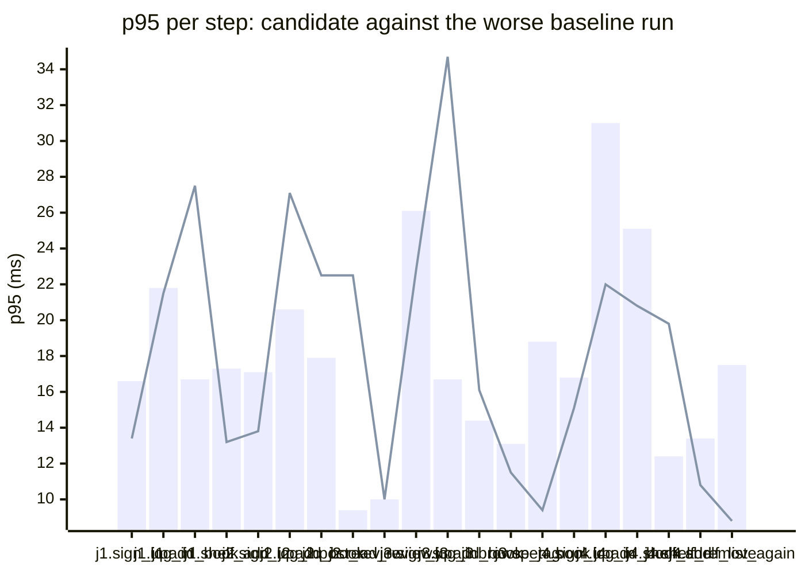

### Downstream report

Candidate `c200eb6f` against baseline `0fa756eb`. Run started 2026-10-23T03:46:35Z, ended 2026-10-23T03:46:43Z. 2 VUs, 10 iterations per VU per pass (cap 60 s), k6 v0.56.0 (commit/50afb99947, go1.23.4, linux/amd64).

**Findings:** regressed steps 2, trade-off journeys 0, improved metrics 0, withheld metrics 7.

#### A new reader signs up, logs in, adds a book and puts it on their shelf

| Step | Baseline p95 (B1 / B2) | Candidate p95 | Change | Noise band | Verdict |
|---|---|---|---|---|---|
| `sign_up` | 16.6 / 8.9 ms | 13.4 ms | -3.2 ms (-19%) | 7.7 ms | noise |
| `log_in` | 16.0 / 21.8 ms | 21.5 ms | -0.3 ms (-1%) | 5.8 ms | noise |
| `add_book` | 16.7 / 11.0 ms | 27.5 ms | +10.8 ms (+65%) | 5.7 ms | noise |
| `shelf_add` | 17.3 / 11.9 ms | 13.2 ms | -4.2 ms (-24%) | 5.4 ms | noise |
| `shelf_list` | 20.3 / 7.1 ms | 10.5 ms | -9.8 ms (-48%) | 13.2 ms | withheld |

#### A reader logs in, reviews a book and reads the reviews

| Step | Baseline p95 (B1 / B2) | Candidate p95 | Change | Noise band | Verdict |
|---|---|---|---|---|---|
| `sign_up` | 15.6 / 17.1 ms | 13.8 ms | -3.3 ms (-19%) | 1.5 ms | noise |
| `log_in` | 20.6 / 13.8 ms | 27.1 ms | +6.5 ms (+32%) | 6.9 ms | noise |
| `add_book` | 17.9 / 14.2 ms | 22.5 ms | +4.6 ms (+26%) | 3.7 ms | noise |
| `post_review` | 9.1 / 9.4 ms | 22.5 ms | +13.1 ms (+138%) | 0.4 ms | regression |
| `read_reviews` | 9.8 / 10.0 ms | 10.0 ms | +0.1 ms (+1%) | 0.1 ms | noise |

#### A visitor browses books by tag and opens one

| Step | Baseline p95 (B1 / B2) | Candidate p95 | Change | Noise band | Verdict |
|---|---|---|---|---|---|
| `sign_up` | 14.0 / 26.1 ms | 22.8 ms | -3.3 ms (-13%) | 12.1 ms | withheld |
| `log_in` | 13.8 / 16.7 ms | 34.7 ms | +18.0 ms (+107%) | 2.9 ms | regression |
| `add_book` | 14.4 / 10.0 ms | 16.1 ms | +1.7 ms (+12%) | 4.3 ms | noise |
| `browse_tag` | 11.6 / 13.1 ms | 11.5 ms | -1.6 ms (-12%) | 1.4 ms | noise |
| `open_book` | 18.8 / 6.4 ms | 9.4 ms | -9.3 ms (-50%) | 12.3 ms | withheld |

#### A reader views their shelf and removes a book

| Step | Baseline p95 (B1 / B2) | Candidate p95 | Change | Noise band | Verdict |
|---|---|---|---|---|---|
| `sign_up` | 15.0 / 16.8 ms | 15.1 ms | -1.7 ms (-10%) | 1.8 ms | noise |
| `log_in` | 31.0 / 19.5 ms | 22.0 ms | -9.0 ms (-29%) | 11.6 ms | withheld |
| `add_book` | 25.1 / 12.1 ms | 20.8 ms | -4.4 ms (-17%) | 13.0 ms | withheld |
| `shelf_add` | 12.4 / 9.4 ms | 19.8 ms | +7.4 ms (+60%) | 3.0 ms | noise |
| `shelf_list` | 20.4 / 7.1 ms | 10.9 ms | -9.6 ms (-47%) | 13.4 ms | withheld |
| `shelf_remove` | 13.3 / 13.4 ms | 10.8 ms | -2.6 ms (-19%) | 0.1 ms | noise |
| `shelf_list_again` | 17.5 / 6.0 ms | 8.8 ms | -8.8 ms (-50%) | 11.6 ms | withheld |

**App process**

| Metric | B1 | C | B2 | Change | Noise band | Verdict |
|---|---|---|---|---|---|---|
| CPU time | 0.86 s | 0.80 s | 0.81 s | -0.06 s (-7%) | 0.05 s | noise |
| Peak RSS | 8.4 MB | 8.1 MB | 8.2 MB | -0.2 MB (-3%) | 0.1 MB | noise |

**p95 per step**

Bars: worse of the two baseline runs. Line: candidate.
The chart shows the 20 steps with the largest change, out of 22.

- j1: A new reader signs up, logs in, adds a book and puts it on their shelf
- j2: A reader logs in, reviews a book and reads the reviews
- j3: A visitor browses books by tag and opens one
- j4: A reader views their shelf and removes a book

**Issues to open**

- `visitor_browses_by_tag.log_in.p95_ms` (2 steps)

2 regressed steps are grouped into 1 by the changed functions on the routes they call; one issue per group.

**Discarded journeys**

none

**Blast radius**

Changed routes:

- `GET /health`: handler (Server).handleHealth itself changed

Affected routes:

- none

*static analysis with go/ast, calls resolved by name, depth 2 from handlers and middleware, a function reached by more than half of all routes is ignored when looking for shared functions; misses dynamic registration, reflection, interface dispatch by other names, and cross-service calls*

**Not measured**

- DB time: not measured; the target exposes no database timing.

**Method.** Baseline run twice (B1, B2) and candidate once (C), in the order B1, C, B2, sequentially on one machine. Three runs give no confidence interval; treat verdicts near the thresholds as uncertain.

Thresholds in effect: a metric is a regression when the candidate is worse than the worse baseline run by more than 2 times the noise band (the difference between B1 and B2), by at least 20%, and by at least 10 ms (latency), 10 MB (memory) or 0.5 s (CPU). A step that passed on both baseline runs and failed on the candidate is a regression. The verdict is withheld when the baseline runs differ by more than 50% of the smaller one and by at least the same minimum, unless the candidate is clearly worse or better than both. A journey with a latency regression and a latency improvement is reported as a trade-off.
