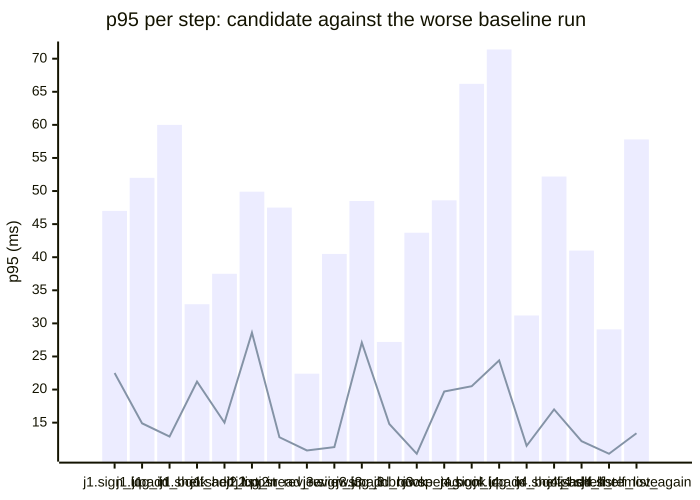

### Downstream report

Candidate `aa75b783` against baseline `0fa756eb`. Run started 2026-10-23T03:28:38Z, ended 2026-10-23T03:28:47Z. 2 VUs, 10 iterations per VU per pass (cap 60 s), k6 v0.56.0 (commit/50afb99947, go1.23.4, linux/amd64).

**Findings:** regressed steps 0, trade-off journeys 0, improved metrics 5, withheld metrics 19.

#### A new reader signs up, logs in, adds a book and puts it on their shelf

| Step | Baseline p95 (B1 / B2) | Candidate p95 | Change | Noise band | Verdict |
|---|---|---|---|---|---|
| `sign_up` | 39.7 / 47.0 ms | 22.5 ms | -24.5 ms (-52%) | 7.3 ms | improved |
| `log_in` | 30.2 / 52.0 ms | 14.9 ms | -37.2 ms (-71%) | 21.9 ms | withheld |
| `add_book` | 60.0 / 24.1 ms | 12.9 ms | -47.1 ms (-79%) | 35.9 ms | withheld |
| `shelf_add` | 32.9 / 16.9 ms | 21.2 ms | -11.7 ms (-36%) | 16.0 ms | withheld |
| `shelf_list` | 37.5 / 13.9 ms | 15.0 ms | -22.6 ms (-60%) | 23.7 ms | withheld |

#### A reader logs in, reviews a book and reads the reviews

| Step | Baseline p95 (B1 / B2) | Candidate p95 | Change | Noise band | Verdict |
|---|---|---|---|---|---|
| `sign_up` | 64.2 / 13.2 ms | 13.7 ms | -50.5 ms (-79%) | 51.0 ms | withheld |
| `log_in` | 29.3 / 49.9 ms | 28.6 ms | -21.4 ms (-43%) | 20.7 ms | withheld |
| `add_book` | 79.8 / 34.4 ms | 15.2 ms | -64.6 ms (-81%) | 45.4 ms | withheld |
| `post_review` | 30.6 / 47.5 ms | 12.8 ms | -34.6 ms (-73%) | 16.9 ms | withheld |
| `read_reviews` | 22.4 / 11.7 ms | 10.8 ms | -11.6 ms (-52%) | 10.7 ms | withheld |

#### A visitor browses books by tag and opens one

| Step | Baseline p95 (B1 / B2) | Candidate p95 | Change | Noise band | Verdict |
|---|---|---|---|---|---|
| `sign_up` | 40.5 / 23.8 ms | 11.3 ms | -29.2 ms (-72%) | 16.7 ms | withheld |
| `log_in` | 39.3 / 48.5 ms | 27.1 ms | -21.3 ms (-44%) | 9.1 ms | noise |
| `add_book` | 27.2 / 17.8 ms | 14.8 ms | -12.4 ms (-46%) | 9.4 ms | noise |
| `browse_tag` | 37.7 / 43.7 ms | 10.3 ms | -33.4 ms (-76%) | 6.0 ms | improved |
| `open_book` | 24.6 / 48.6 ms | 19.7 ms | -28.9 ms (-59%) | 24.0 ms | withheld |

#### A reader views their shelf and removes a book

| Step | Baseline p95 (B1 / B2) | Candidate p95 | Change | Noise band | Verdict |
|---|---|---|---|---|---|
| `sign_up` | 66.2 / 25.2 ms | 20.5 ms | -45.7 ms (-69%) | 40.9 ms | withheld |
| `log_in` | 71.4 / 29.2 ms | 24.4 ms | -47.0 ms (-66%) | 42.2 ms | withheld |
| `add_book` | 15.4 / 31.2 ms | 11.5 ms | -19.7 ms (-63%) | 15.8 ms | withheld |
| `shelf_add` | 52.2 / 23.4 ms | 17.0 ms | -35.2 ms (-67%) | 28.8 ms | withheld |
| `shelf_list` | 41.0 / 31.8 ms | 12.2 ms | -28.9 ms (-70%) | 9.2 ms | improved |
| `shelf_remove` | 29.1 / 27.0 ms | 10.3 ms | -18.9 ms (-65%) | 2.2 ms | improved |
| `shelf_list_again` | 57.8 / 50.1 ms | 13.4 ms | -44.4 ms (-77%) | 7.6 ms | improved |

**App process**

| Metric | B1 | C | B2 | Change | Noise band | Verdict |
|---|---|---|---|---|---|---|
| CPU time | 1.76 s | 0.95 s | 1.48 s | -0.81 s (-46%) | 0.28 s | noise |
| Peak RSS | 8.0 MB | 8.0 MB | 8.4 MB | -0.4 MB (-4%) | 0.4 MB | noise |

**p95 per step**

Bars: worse of the two baseline runs. Line: candidate.
The chart shows the 20 steps with the largest change, out of 22.

- j1: A new reader signs up, logs in, adds a book and puts it on their shelf
- j2: A reader logs in, reviews a book and reads the reviews
- j3: A visitor browses books by tag and opens one
- j4: A reader views their shelf and removes a book

**Issues to open**

none

**Discarded journeys**

none

**Blast radius**

Changed routes:

- `GET /health`: handler (Server).handleHealth itself changed

Affected routes:

- none

*static analysis with go/ast, calls resolved by name, depth 2 from handlers and middleware, a function reached by more than half of all routes is ignored when looking for shared functions; misses dynamic registration, reflection, interface dispatch by other names, and cross-service calls*

**Not measured**

- DB time: not measured; the target exposes no database timing.

**Method.** Baseline run twice (B1, B2) and candidate once (C), in the order B1, C, B2, sequentially on one machine. Three runs give no confidence interval; treat verdicts near the thresholds as uncertain.

Thresholds in effect: a metric is a regression when the candidate is worse than the worse baseline run by more than 2 times the noise band (the difference between B1 and B2), by at least 20%, and by at least 10 ms (latency), 10 MB (memory) or 0.5 s (CPU). A step that passed on both baseline runs and failed on the candidate is a regression. The verdict is withheld when the baseline runs differ by more than 50% of the smaller one and by at least the same minimum, unless the candidate is clearly worse or better than both. A journey with a latency regression and a latency improvement is reported as a trade-off.
