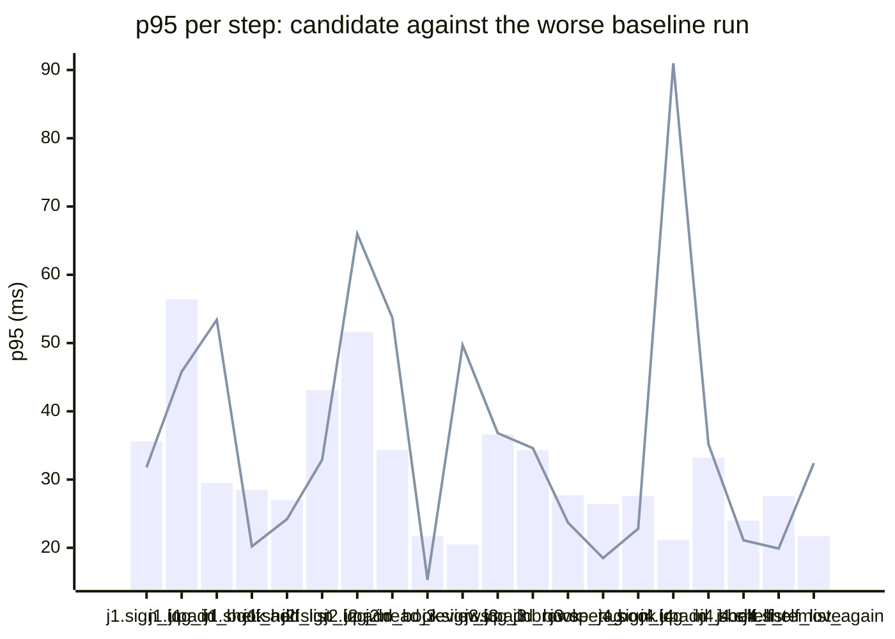

### Downstream report

Candidate `0aa83238` against baseline `0fa756eb`. Run started 2026-10-23T03:28:51Z, ended 2026-10-23T03:29:03Z. 2 VUs, 10 iterations per VU per pass (cap 60 s), k6 v0.56.0 (commit/50afb99947, go1.23.4, linux/amd64).

**Findings:** regressed steps 4, trade-off journeys 0, improved metrics 0, withheld metrics 10.

#### A new reader signs up, logs in, adds a book and puts it on their shelf

| Step | Baseline p95 (B1 / B2) | Candidate p95 | Change | Noise band | Verdict |
|---|---|---|---|---|---|
| `sign_up` | 35.6 / 18.7 ms | 31.8 ms | -3.8 ms (-11%) | 16.9 ms | withheld |
| `log_in` | 56.4 / 16.9 ms | 45.8 ms | -10.6 ms (-19%) | 39.5 ms | withheld |
| `add_book` | 29.5 / 18.1 ms | 53.4 ms | +23.9 ms (+81%) | 11.4 ms | regression |
| `shelf_add` | 28.5 / 20.0 ms | 20.2 ms | -8.3 ms (-29%) | 8.4 ms | noise |
| `shelf_list` | 19.4 / 27.0 ms | 24.2 ms | -2.8 ms (-10%) | 7.6 ms | noise |

#### A reader logs in, reviews a book and reads the reviews

| Step | Baseline p95 (B1 / B2) | Candidate p95 | Change | Noise band | Verdict |
|---|---|---|---|---|---|
| `sign_up` | 43.1 / 20.1 ms | 32.9 ms | -10.2 ms (-24%) | 23.0 ms | withheld |
| `log_in` | 30.9 / 51.6 ms | 66.0 ms | +14.4 ms (+28%) | 20.8 ms | withheld |
| `add_book` | 23.7 / 34.3 ms | 53.7 ms | +19.5 ms (+57%) | 10.6 ms | noise |
| `post_review` | 31.2 / 13.8 ms | 19.1 ms | -12.1 ms (-39%) | 17.4 ms | withheld |
| `read_reviews` | 21.7 / 13.3 ms | 15.3 ms | -6.4 ms (-30%) | 8.4 ms | noise |

#### A visitor browses books by tag and opens one

| Step | Baseline p95 (B1 / B2) | Candidate p95 | Change | Noise band | Verdict |
|---|---|---|---|---|---|
| `sign_up` | 20.5 / 16.9 ms | 49.7 ms | +29.2 ms (+143%) | 3.5 ms | regression |
| `log_in` | 36.6 / 26.5 ms | 36.8 ms | +0.2 ms (+0%) | 10.2 ms | noise |
| `add_book` | 25.4 / 34.3 ms | 34.6 ms | +0.3 ms (+1%) | 8.9 ms | noise |
| `browse_tag` | 27.7 / 12.2 ms | 23.7 ms | -4.0 ms (-14%) | 15.5 ms | withheld |
| `open_book` | 26.4 / 13.4 ms | 18.5 ms | -7.9 ms (-30%) | 13.1 ms | withheld |

#### A reader views their shelf and removes a book

| Step | Baseline p95 (B1 / B2) | Candidate p95 | Change | Noise band | Verdict |
|---|---|---|---|---|---|
| `sign_up` | 27.6 / 17.3 ms | 22.8 ms | -4.9 ms (-18%) | 10.3 ms | withheld |
| `log_in` | 21.1 / 19.1 ms | 91.0 ms | +70.0 ms (+332%) | 2.0 ms | regression |
| `add_book` | 33.2 / 17.5 ms | 35.2 ms | +2.1 ms (+6%) | 15.6 ms | withheld |
| `shelf_add` | 42.3 / 28.5 ms | 27.7 ms | -14.6 ms (-35%) | 13.8 ms | noise |
| `shelf_list` | 24.0 / 20.4 ms | 21.1 ms | -2.9 ms (-12%) | 3.6 ms | noise |
| `shelf_remove` | 27.6 / 18.6 ms | 19.9 ms | -7.6 ms (-28%) | 9.0 ms | noise |
| `shelf_list_again` | 21.7 / 16.8 ms | 32.4 ms | +10.7 ms (+50%) | 4.8 ms | regression |

**App process**

| Metric | B1 | C | B2 | Change | Noise band | Verdict |
|---|---|---|---|---|---|---|
| CPU time | 1.19 s | 1.18 s | 1.04 s | -0.01 s (-1%) | 0.15 s | noise |
| Peak RSS | 8.1 MB | 8.4 MB | 8.0 MB | +0.2 MB (+3%) | 0.1 MB | noise |

**p95 per step**

Bars: worse of the two baseline runs. Line: candidate.
The chart shows the 20 steps with the largest change, out of 22.

- j1: A new reader signs up, logs in, adds a book and puts it on their shelf
- j2: A reader logs in, reviews a book and reads the reviews
- j3: A visitor browses books by tag and opens one
- j4: A reader views their shelf and removes a book

**Issues to open**

- `reader_tidies_shelf.log_in.p95_ms` (4 steps)

4 regressed steps are grouped into 1 by the changed functions on the routes they call; one issue per group.

**Discarded journeys**

none

**Blast radius**

Changed routes:

- `GET /health`: handler (Server).handleHealth itself changed

Affected routes:

- none

*static analysis with go/ast, calls resolved by name, depth 2 from handlers and middleware, a function reached by more than half of all routes is ignored when looking for shared functions; misses dynamic registration, reflection, interface dispatch by other names, and cross-service calls*

**Not measured**

- DB time: not measured; the target exposes no database timing.

**Method.** Baseline run twice (B1, B2) and candidate once (C), in the order B1, C, B2, sequentially on one machine. Three runs give no confidence interval; treat verdicts near the thresholds as uncertain.

Thresholds in effect: a metric is a regression when the candidate is worse than the worse baseline run by more than 2 times the noise band (the difference between B1 and B2), by at least 20%, and by at least 10 ms (latency), 10 MB (memory) or 0.5 s (CPU). A step that passed on both baseline runs and failed on the candidate is a regression. The verdict is withheld when the baseline runs differ by more than 50% of the smaller one and by at least the same minimum, unless the candidate is clearly worse or better than both. A journey with a latency regression and a latency improvement is reported as a trade-off.
