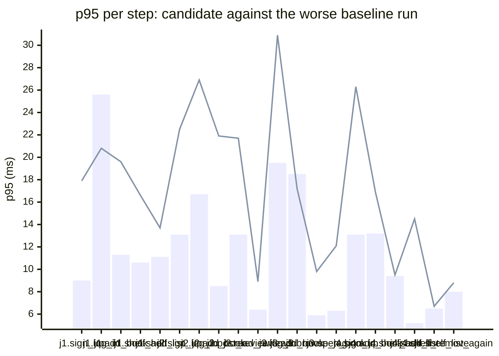

### Downstream report

Candidate `8187179a` against baseline `0fa756eb`. Run started 2026-10-23T03:29:05Z, ended 2026-10-23T03:29:11Z. 2 VUs, 10 iterations per VU per pass (cap 60 s), k6 v0.56.0 (commit/50afb99947, go1.23.4, linux/amd64).

**Findings:** regressed steps 3, trade-off journeys 0, improved metrics 0, withheld metrics 3.

#### A new reader signs up, logs in, adds a book and puts it on their shelf

| Step | Baseline p95 (B1 / B2) | Candidate p95 | Change | Noise band | Verdict |
|---|---|---|---|---|---|
| `sign_up` | 9.0 / 7.3 ms | 17.9 ms | +8.8 ms (+98%) | 1.8 ms | noise |
| `log_in` | 15.5 / 25.6 ms | 20.8 ms | -4.8 ms (-19%) | 10.1 ms | withheld |
| `add_book` | 5.3 / 11.3 ms | 19.6 ms | +8.3 ms (+73%) | 6.0 ms | noise |
| `shelf_add` | 10.6 / 7.7 ms | 16.6 ms | +6.0 ms (+57%) | 2.9 ms | noise |
| `shelf_list` | 11.1 / 10.0 ms | 13.7 ms | +2.7 ms (+24%) | 1.0 ms | noise |

#### A reader logs in, reviews a book and reads the reviews

| Step | Baseline p95 (B1 / B2) | Candidate p95 | Change | Noise band | Verdict |
|---|---|---|---|---|---|
| `sign_up` | 13.1 / 8.2 ms | 22.5 ms | +9.3 ms (+71%) | 4.9 ms | noise |
| `log_in` | 12.1 / 16.7 ms | 26.9 ms | +10.2 ms (+61%) | 4.6 ms | regression |
| `add_book` | 8.5 / 8.2 ms | 21.9 ms | +13.3 ms (+156%) | 0.3 ms | regression |
| `post_review` | 11.2 / 13.1 ms | 21.7 ms | +8.6 ms (+65%) | 1.9 ms | noise |
| `read_reviews` | 5.4 / 6.4 ms | 8.9 ms | +2.6 ms (+40%) | 0.9 ms | noise |

#### A visitor browses books by tag and opens one

| Step | Baseline p95 (B1 / B2) | Candidate p95 | Change | Noise band | Verdict |
|---|---|---|---|---|---|
| `sign_up` | 13.7 / 22.6 ms | 14.2 ms | -8.4 ms (-37%) | 8.9 ms | noise |
| `log_in` | 8.9 / 19.5 ms | 30.9 ms | +11.4 ms (+58%) | 10.6 ms | withheld |
| `add_book` | 7.2 / 18.5 ms | 17.2 ms | -1.3 ms (-7%) | 11.3 ms | withheld |
| `browse_tag` | 5.9 / 4.0 ms | 9.8 ms | +3.9 ms (+66%) | 1.9 ms | noise |
| `open_book` | 4.6 / 6.3 ms | 12.1 ms | +5.8 ms (+92%) | 1.7 ms | noise |

#### A reader views their shelf and removes a book

| Step | Baseline p95 (B1 / B2) | Candidate p95 | Change | Noise band | Verdict |
|---|---|---|---|---|---|
| `sign_up` | 13.1 / 12.5 ms | 26.3 ms | +13.2 ms (+100%) | 0.6 ms | regression |
| `log_in` | 15.2 / 23.6 ms | 18.2 ms | -5.4 ms (-23%) | 8.3 ms | noise |
| `add_book` | 7.4 / 13.2 ms | 16.9 ms | +3.6 ms (+27%) | 5.8 ms | noise |
| `shelf_add` | 4.9 / 9.4 ms | 9.5 ms | +0.1 ms (+1%) | 4.5 ms | noise |
| `shelf_list` | 4.6 / 5.2 ms | 14.5 ms | +9.3 ms (+179%) | 0.6 ms | noise |
| `shelf_remove` | 6.5 / 6.4 ms | 6.7 ms | +0.2 ms (+3%) | 0.2 ms | noise |
| `shelf_list_again` | 4.0 / 8.0 ms | 8.8 ms | +0.8 ms (+10%) | 4.0 ms | noise |

**App process**

| Metric | B1 | C | B2 | Change | Noise band | Verdict |
|---|---|---|---|---|---|---|
| CPU time | 0.86 s | 0.84 s | 0.79 s | -0.02 s (-2%) | 0.07 s | noise |
| Peak RSS | 8.0 MB | 8.4 MB | 7.9 MB | +0.4 MB (+5%) | 0.1 MB | noise |

**p95 per step**

Bars: worse of the two baseline runs. Line: candidate.
The chart shows the 20 steps with the largest change, out of 22.

- j1: A new reader signs up, logs in, adds a book and puts it on their shelf
- j2: A reader logs in, reviews a book and reads the reviews
- j3: A visitor browses books by tag and opens one
- j4: A reader views their shelf and removes a book

**Issues to open**

- `reader_reviews_book.add_book.p95_ms` (3 steps)

3 regressed steps are grouped into 1 by the changed functions on the routes they call; one issue per group.

**Discarded journeys**

none

**Blast radius**

Changed routes:

- `GET /health`: handler (Server).handleHealth itself changed

Affected routes:

- none

*static analysis with go/ast, calls resolved by name, depth 2 from handlers and middleware, a function reached by more than half of all routes is ignored when looking for shared functions; misses dynamic registration, reflection, interface dispatch by other names, and cross-service calls*

**Not measured**

- DB time: not measured; the target exposes no database timing.

**Method.** Baseline run twice (B1, B2) and candidate once (C), in the order B1, C, B2, sequentially on one machine. Three runs give no confidence interval; treat verdicts near the thresholds as uncertain.

Thresholds in effect: a metric is a regression when the candidate is worse than the worse baseline run by more than 2 times the noise band (the difference between B1 and B2), by at least 20%, and by at least 10 ms (latency), 10 MB (memory) or 0.5 s (CPU). A step that passed on both baseline runs and failed on the candidate is a regression. The verdict is withheld when the baseline runs differ by more than 50% of the smaller one and by at least the same minimum, unless the candidate is clearly worse or better than both. A journey with a latency regression and a latency improvement is reported as a trade-off.
