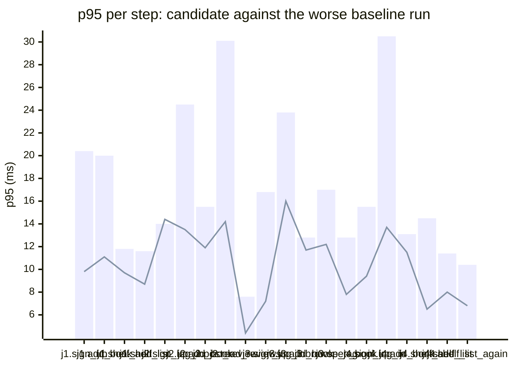

### Downstream report

Candidate `79924a56` against baseline `0fa756eb`. Run started 2026-10-23T03:29:13Z, ended 2026-10-23T03:29:20Z. 2 VUs, 10 iterations per VU per pass (cap 60 s), k6 v0.56.0 (commit/50afb99947, go1.23.4, linux/amd64).

**Findings:** regressed steps 0, trade-off journeys 0, improved metrics 0, withheld metrics 2.

#### A new reader signs up, logs in, adds a book and puts it on their shelf

| Step | Baseline p95 (B1 / B2) | Candidate p95 | Change | Noise band | Verdict |
|---|---|---|---|---|---|
| `sign_up` | 20.4 / 18.4 ms | 9.8 ms | -10.6 ms (-52%) | 2.0 ms | noise |
| `log_in` | 41.7 / 24.9 ms | 11.5 ms | -30.3 ms (-73%) | 16.8 ms | withheld |
| `add_book` | 11.7 / 20.0 ms | 11.1 ms | -8.9 ms (-45%) | 8.3 ms | noise |
| `shelf_add` | 8.5 / 11.8 ms | 9.7 ms | -2.2 ms (-18%) | 3.3 ms | noise |
| `shelf_list` | 11.6 / 9.9 ms | 8.7 ms | -3.0 ms (-25%) | 1.7 ms | noise |

#### A reader logs in, reviews a book and reads the reviews

| Step | Baseline p95 (B1 / B2) | Candidate p95 | Change | Noise band | Verdict |
|---|---|---|---|---|---|
| `sign_up` | 14.0 / 10.5 ms | 14.4 ms | +0.4 ms (+3%) | 3.5 ms | noise |
| `log_in` | 24.5 / 17.5 ms | 13.5 ms | -11.0 ms (-45%) | 7.0 ms | noise |
| `add_book` | 15.4 / 15.5 ms | 11.9 ms | -3.6 ms (-23%) | 0.2 ms | noise |
| `post_review` | 22.0 / 30.1 ms | 14.2 ms | -15.9 ms (-53%) | 8.1 ms | noise |
| `read_reviews` | 7.6 / 4.9 ms | 4.4 ms | -3.2 ms (-43%) | 2.7 ms | noise |

#### A visitor browses books by tag and opens one

| Step | Baseline p95 (B1 / B2) | Candidate p95 | Change | Noise band | Verdict |
|---|---|---|---|---|---|
| `sign_up` | 16.8 / 13.4 ms | 7.2 ms | -9.6 ms (-57%) | 3.5 ms | noise |
| `log_in` | 23.8 / 23.1 ms | 16.0 ms | -7.8 ms (-33%) | 0.7 ms | noise |
| `add_book` | 12.8 / 10.1 ms | 11.7 ms | -1.1 ms (-8%) | 2.7 ms | noise |
| `browse_tag` | 17.0 / 9.8 ms | 12.2 ms | -4.8 ms (-28%) | 7.2 ms | noise |
| `open_book` | 7.2 / 12.8 ms | 7.8 ms | -5.0 ms (-39%) | 5.6 ms | noise |

#### A reader views their shelf and removes a book

| Step | Baseline p95 (B1 / B2) | Candidate p95 | Change | Noise band | Verdict |
|---|---|---|---|---|---|
| `sign_up` | 15.5 / 13.9 ms | 9.4 ms | -6.1 ms (-39%) | 1.5 ms | noise |
| `log_in` | 30.5 / 22.5 ms | 13.7 ms | -16.9 ms (-55%) | 8.0 ms | noise |
| `add_book` | 11.6 / 13.1 ms | 11.5 ms | -1.7 ms (-13%) | 1.5 ms | noise |
| `shelf_add` | 14.5 / 6.8 ms | 6.5 ms | -8.1 ms (-56%) | 7.7 ms | noise |
| `shelf_list` | 11.4 / 9.3 ms | 8.0 ms | -3.4 ms (-30%) | 2.2 ms | noise |
| `shelf_remove` | 21.9 / 9.8 ms | 4.8 ms | -17.1 ms (-78%) | 12.2 ms | withheld |
| `shelf_list_again` | 10.4 / 9.4 ms | 6.8 ms | -3.6 ms (-34%) | 1.0 ms | noise |

**App process**

| Metric | B1 | C | B2 | Change | Noise band | Verdict |
|---|---|---|---|---|---|---|
| CPU time | 0.82 s | 0.77 s | 0.84 s | -0.07 s (-8%) | 0.02 s | noise |
| Peak RSS | 8.1 MB | 8.2 MB | 8.0 MB | +0.1 MB (+2%) | 0.1 MB | noise |

**p95 per step**

Bars: worse of the two baseline runs. Line: candidate.
The chart shows the 20 steps with the largest change, out of 22.

- j1: A new reader signs up, logs in, adds a book and puts it on their shelf
- j2: A reader logs in, reviews a book and reads the reviews
- j3: A visitor browses books by tag and opens one
- j4: A reader views their shelf and removes a book

**Issues to open**

none

**Discarded journeys**

none

**Blast radius**

Changed routes:

- `GET /health`: handler (Server).handleHealth itself changed

Affected routes:

- none

*static analysis with go/ast, calls resolved by name, depth 2 from handlers and middleware, a function reached by more than half of all routes is ignored when looking for shared functions; misses dynamic registration, reflection, interface dispatch by other names, and cross-service calls*

**Not measured**

- DB time: not measured; the target exposes no database timing.

**Method.** Baseline run twice (B1, B2) and candidate once (C), in the order B1, C, B2, sequentially on one machine. Three runs give no confidence interval; treat verdicts near the thresholds as uncertain.

Thresholds in effect: a metric is a regression when the candidate is worse than the worse baseline run by more than 2 times the noise band (the difference between B1 and B2), by at least 20%, and by at least 10 ms (latency), 10 MB (memory) or 0.5 s (CPU). A step that passed on both baseline runs and failed on the candidate is a regression. The verdict is withheld when the baseline runs differ by more than 50% of the smaller one and by at least the same minimum, unless the candidate is clearly worse or better than both. A journey with a latency regression and a latency improvement is reported as a trade-off.
