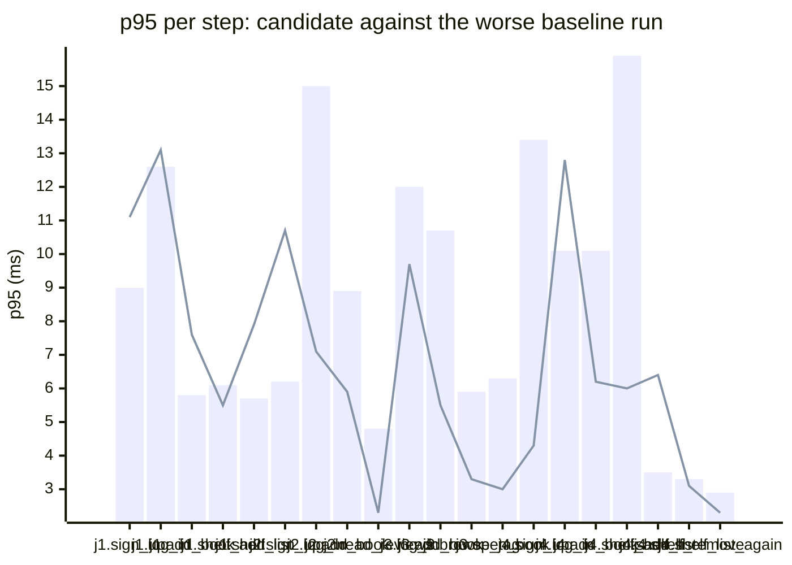

### Downstream report

Candidate `8f6a38cf` against baseline `0fa756eb`. Run started 2026-10-23T03:29:22Z, ended 2026-10-23T03:29:27Z. 2 VUs, 10 iterations per VU per pass (cap 60 s), k6 v0.56.0 (commit/50afb99947, go1.23.4, linux/amd64).

**Findings:** regressed steps 0, trade-off journeys 0, improved metrics 0, withheld metrics 2.

#### A new reader signs up, logs in, adds a book and puts it on their shelf

| Step | Baseline p95 (B1 / B2) | Candidate p95 | Change | Noise band | Verdict |
|---|---|---|---|---|---|
| `sign_up` | 9.0 / 4.5 ms | 11.1 ms | +2.1 ms (+23%) | 4.5 ms | noise |
| `log_in` | 12.6 / 8.2 ms | 13.1 ms | +0.5 ms (+4%) | 4.4 ms | noise |
| `add_book` | 5.0 / 5.8 ms | 7.6 ms | +1.8 ms (+30%) | 0.8 ms | noise |
| `shelf_add` | 6.1 / 4.7 ms | 5.5 ms | -0.6 ms (-10%) | 1.5 ms | noise |
| `shelf_list` | 5.7 / 4.7 ms | 7.9 ms | +2.2 ms (+38%) | 1.0 ms | noise |

#### A reader logs in, reviews a book and reads the reviews

| Step | Baseline p95 (B1 / B2) | Candidate p95 | Change | Noise band | Verdict |
|---|---|---|---|---|---|
| `sign_up` | 6.2 / 4.3 ms | 10.7 ms | +4.5 ms (+73%) | 1.8 ms | noise |
| `log_in` | 15.0 / 6.4 ms | 7.1 ms | -7.9 ms (-53%) | 8.6 ms | noise |
| `add_book` | 8.9 / 5.3 ms | 5.9 ms | -3.0 ms (-34%) | 3.6 ms | noise |
| `post_review` | 17.1 / 7.2 ms | 4.7 ms | -12.3 ms (-72%) | 9.9 ms | noise |
| `read_reviews` | 4.8 / 3.2 ms | 2.3 ms | -2.5 ms (-52%) | 1.6 ms | noise |

#### A visitor browses books by tag and opens one

| Step | Baseline p95 (B1 / B2) | Candidate p95 | Change | Noise band | Verdict |
|---|---|---|---|---|---|
| `sign_up` | 20.8 / 3.5 ms | 7.1 ms | -13.7 ms (-66%) | 17.2 ms | withheld |
| `log_in` | 12.0 / 7.0 ms | 9.7 ms | -2.3 ms (-19%) | 5.1 ms | noise |
| `add_book` | 10.7 / 5.3 ms | 5.5 ms | -5.2 ms (-49%) | 5.4 ms | noise |
| `browse_tag` | 5.9 / 4.0 ms | 3.3 ms | -2.6 ms (-44%) | 1.9 ms | noise |
| `open_book` | 6.3 / 5.3 ms | 3.0 ms | -3.3 ms (-52%) | 1.0 ms | noise |

#### A reader views their shelf and removes a book

| Step | Baseline p95 (B1 / B2) | Candidate p95 | Change | Noise band | Verdict |
|---|---|---|---|---|---|
| `sign_up` | 13.4 / 12.3 ms | 4.3 ms | -9.1 ms (-68%) | 1.1 ms | noise |
| `log_in` | 10.1 / 5.9 ms | 12.8 ms | +2.6 ms (+26%) | 4.2 ms | noise |
| `add_book` | 10.1 / 3.4 ms | 6.2 ms | -3.9 ms (-38%) | 6.6 ms | noise |
| `shelf_add` | 15.9 / 3.4 ms | 6.0 ms | -9.9 ms (-62%) | 12.5 ms | withheld |
| `shelf_list` | 3.5 / 2.9 ms | 6.4 ms | +2.9 ms (+82%) | 0.6 ms | noise |
| `shelf_remove` | 3.3 / 3.1 ms | 3.1 ms | -0.2 ms (-5%) | 0.2 ms | noise |
| `shelf_list_again` | 2.9 / 2.2 ms | 2.3 ms | -0.6 ms (-20%) | 0.8 ms | noise |

**App process**

| Metric | B1 | C | B2 | Change | Noise band | Verdict |
|---|---|---|---|---|---|---|
| CPU time | 0.79 s | 0.73 s | 0.69 s | -0.06 s (-8%) | 0.10 s | noise |
| Peak RSS | 8.2 MB | 8.0 MB | 8.0 MB | -0.2 MB (-3%) | 0.2 MB | noise |

**p95 per step**

Bars: worse of the two baseline runs. Line: candidate.
The chart shows the 20 steps with the largest change, out of 22.

- j1: A new reader signs up, logs in, adds a book and puts it on their shelf
- j2: A reader logs in, reviews a book and reads the reviews
- j3: A visitor browses books by tag and opens one
- j4: A reader views their shelf and removes a book

**Issues to open**

none

**Discarded journeys**

none

**Blast radius**

Changed routes:

- `GET /health`: handler (Server).handleHealth itself changed

Affected routes:

- none

*static analysis with go/ast, calls resolved by name, depth 2 from handlers and middleware, a function reached by more than half of all routes is ignored when looking for shared functions; misses dynamic registration, reflection, interface dispatch by other names, and cross-service calls*

**Not measured**

- DB time: not measured; the target exposes no database timing.

**Method.** Baseline run twice (B1, B2) and candidate once (C), in the order B1, C, B2, sequentially on one machine. Three runs give no confidence interval; treat verdicts near the thresholds as uncertain.

Thresholds in effect: a metric is a regression when the candidate is worse than the worse baseline run by more than 2 times the noise band (the difference between B1 and B2), by at least 20%, and by at least 10 ms (latency), 10 MB (memory) or 0.5 s (CPU). A step that passed on both baseline runs and failed on the candidate is a regression. The verdict is withheld when the baseline runs differ by more than 50% of the smaller one and by at least the same minimum, unless the candidate is clearly worse or better than both. A journey with a latency regression and a latency improvement is reported as a trade-off.
