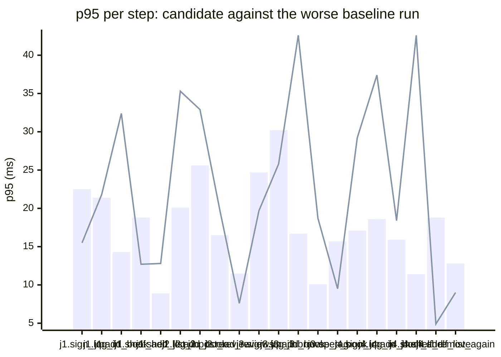

### Downstream report

Candidate `4615228c` against baseline `0fa756eb`. Run started 2026-10-23T03:29:29Z, ended 2026-10-23T03:29:36Z. 2 VUs, 10 iterations per VU per pass (cap 60 s), k6 v0.56.0 (commit/50afb99947, go1.23.4, linux/amd64).

**Findings:** regressed steps 5, trade-off journeys 0, improved metrics 0, withheld metrics 7.

#### A new reader signs up, logs in, adds a book and puts it on their shelf

| Step | Baseline p95 (B1 / B2) | Candidate p95 | Change | Noise band | Verdict |
|---|---|---|---|---|---|
| `sign_up` | 9.1 / 22.5 ms | 15.5 ms | -7.1 ms (-31%) | 13.4 ms | withheld |
| `log_in` | 15.0 / 21.4 ms | 21.8 ms | +0.4 ms (+2%) | 6.4 ms | noise |
| `add_book` | 6.5 / 14.3 ms | 32.4 ms | +18.1 ms (+127%) | 7.8 ms | regression |
| `shelf_add` | 13.2 / 18.8 ms | 12.7 ms | -6.2 ms (-33%) | 5.6 ms | noise |
| `shelf_list` | 8.2 / 8.9 ms | 12.8 ms | +3.9 ms (+43%) | 0.7 ms | noise |

#### A reader logs in, reviews a book and reads the reviews

| Step | Baseline p95 (B1 / B2) | Candidate p95 | Change | Noise band | Verdict |
|---|---|---|---|---|---|
| `sign_up` | 10.0 / 32.1 ms | 16.5 ms | -15.6 ms (-49%) | 22.1 ms | withheld |
| `log_in` | 16.4 / 20.1 ms | 35.3 ms | +15.2 ms (+75%) | 3.7 ms | regression |
| `add_book` | 11.0 / 25.6 ms | 32.9 ms | +7.3 ms (+28%) | 14.6 ms | withheld |
| `post_review` | 7.6 / 16.5 ms | 19.9 ms | +3.4 ms (+21%) | 8.9 ms | noise |
| `read_reviews` | 5.8 / 11.5 ms | 7.6 ms | -3.9 ms (-34%) | 5.7 ms | noise |

#### A visitor browses books by tag and opens one

| Step | Baseline p95 (B1 / B2) | Candidate p95 | Change | Noise band | Verdict |
|---|---|---|---|---|---|
| `sign_up` | 15.7 / 24.7 ms | 19.7 ms | -5.0 ms (-20%) | 9.0 ms | noise |
| `log_in` | 12.8 / 30.2 ms | 25.8 ms | -4.3 ms (-14%) | 17.4 ms | withheld |
| `add_book` | 11.0 / 16.7 ms | 42.6 ms | +25.8 ms (+154%) | 5.7 ms | regression |
| `browse_tag` | 6.7 / 10.1 ms | 18.7 ms | +8.6 ms (+85%) | 3.4 ms | noise |
| `open_book` | 5.2 / 15.7 ms | 9.5 ms | -6.3 ms (-40%) | 10.5 ms | withheld |

#### A reader views their shelf and removes a book

| Step | Baseline p95 (B1 / B2) | Candidate p95 | Change | Noise band | Verdict |
|---|---|---|---|---|---|
| `sign_up` | 10.2 / 17.1 ms | 29.2 ms | +12.1 ms (+70%) | 6.9 ms | noise |
| `log_in` | 11.4 / 18.6 ms | 37.4 ms | +18.8 ms (+101%) | 7.3 ms | regression |
| `add_book` | 13.0 / 15.9 ms | 18.4 ms | +2.6 ms (+16%) | 2.9 ms | noise |
| `shelf_add` | 11.4 / 11.3 ms | 42.6 ms | +31.2 ms (+274%) | 0.0 ms | regression |
| `shelf_list` | 6.7 / 21.6 ms | 6.0 ms | -15.6 ms (-72%) | 14.9 ms | withheld |
| `shelf_remove` | 7.6 / 18.8 ms | 4.9 ms | -14.0 ms (-74%) | 11.2 ms | withheld |
| `shelf_list_again` | 6.1 / 12.8 ms | 9.0 ms | -3.8 ms (-30%) | 6.6 ms | noise |

**App process**

| Metric | B1 | C | B2 | Change | Noise band | Verdict |
|---|---|---|---|---|---|---|
| CPU time | 0.78 s | 0.98 s | 1.08 s | -0.10 s (-9%) | 0.30 s | noise |
| Peak RSS | 8.1 MB | 8.1 MB | 8.2 MB | -0.1 MB (-2%) | 0.1 MB | noise |

**p95 per step**

Bars: worse of the two baseline runs. Line: candidate.
The chart shows the 20 steps with the largest change, out of 22.

- j1: A new reader signs up, logs in, adds a book and puts it on their shelf
- j2: A reader logs in, reviews a book and reads the reviews
- j3: A visitor browses books by tag and opens one
- j4: A reader views their shelf and removes a book

**Issues to open**

- `reader_tidies_shelf.shelf_add.p95_ms` (5 steps)

5 regressed steps are grouped into 1 by the changed functions on the routes they call; one issue per group.

**Discarded journeys**

none

**Blast radius**

Changed routes:

- `GET /health`: handler (Server).handleHealth itself changed

Affected routes:

- none

*static analysis with go/ast, calls resolved by name, depth 2 from handlers and middleware, a function reached by more than half of all routes is ignored when looking for shared functions; misses dynamic registration, reflection, interface dispatch by other names, and cross-service calls*

**Not measured**

- DB time: not measured; the target exposes no database timing.

**Method.** Baseline run twice (B1, B2) and candidate once (C), in the order B1, C, B2, sequentially on one machine. Three runs give no confidence interval; treat verdicts near the thresholds as uncertain.

Thresholds in effect: a metric is a regression when the candidate is worse than the worse baseline run by more than 2 times the noise band (the difference between B1 and B2), by at least 20%, and by at least 10 ms (latency), 10 MB (memory) or 0.5 s (CPU). A step that passed on both baseline runs and failed on the candidate is a regression. The verdict is withheld when the baseline runs differ by more than 50% of the smaller one and by at least the same minimum, unless the candidate is clearly worse or better than both. A journey with a latency regression and a latency improvement is reported as a trade-off.
