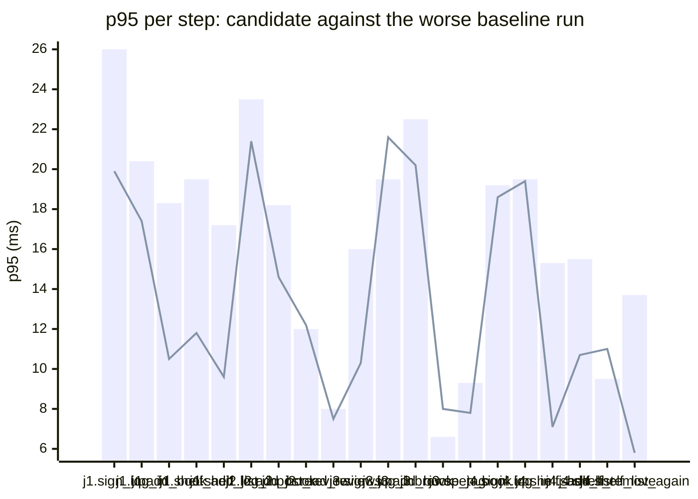

### Downstream report

Candidate `6594bbf7` against baseline `0fa756eb`. Run started 2026-10-23T03:29:39Z, ended 2026-10-23T03:29:46Z. 2 VUs, 10 iterations per VU per pass (cap 60 s), k6 v0.56.0 (commit/50afb99947, go1.23.4, linux/amd64).

**Findings:** regressed steps 0, trade-off journeys 0, improved metrics 0, withheld metrics 13.

#### A new reader signs up, logs in, adds a book and puts it on their shelf

| Step | Baseline p95 (B1 / B2) | Candidate p95 | Change | Noise band | Verdict |
|---|---|---|---|---|---|
| `sign_up` | 26.0 / 12.1 ms | 19.9 ms | -6.1 ms (-24%) | 13.9 ms | withheld |
| `log_in` | 20.4 / 13.7 ms | 17.4 ms | -3.0 ms (-15%) | 6.7 ms | noise |
| `add_book` | 18.3 / 4.9 ms | 10.5 ms | -7.8 ms (-42%) | 13.4 ms | withheld |
| `shelf_add` | 19.5 / 4.2 ms | 11.8 ms | -7.7 ms (-40%) | 15.4 ms | withheld |
| `shelf_list` | 17.2 / 4.2 ms | 9.6 ms | -7.6 ms (-44%) | 13.0 ms | withheld |

#### A reader logs in, reviews a book and reads the reviews

| Step | Baseline p95 (B1 / B2) | Candidate p95 | Change | Noise band | Verdict |
|---|---|---|---|---|---|
| `sign_up` | 46.2 / 4.6 ms | 10.0 ms | -36.2 ms (-78%) | 41.6 ms | withheld |
| `log_in` | 23.5 / 6.4 ms | 21.4 ms | -2.1 ms (-9%) | 17.1 ms | withheld |
| `add_book` | 18.2 / 3.6 ms | 14.6 ms | -3.6 ms (-20%) | 14.6 ms | withheld |
| `post_review` | 12.0 / 4.9 ms | 12.2 ms | +0.2 ms (+2%) | 7.1 ms | noise |
| `read_reviews` | 8.0 / 7.3 ms | 7.5 ms | -0.6 ms (-7%) | 0.7 ms | noise |

#### A visitor browses books by tag and opens one

| Step | Baseline p95 (B1 / B2) | Candidate p95 | Change | Noise band | Verdict |
|---|---|---|---|---|---|
| `sign_up` | 16.0 / 7.5 ms | 10.3 ms | -5.8 ms (-36%) | 8.6 ms | noise |
| `log_in` | 19.5 / 8.6 ms | 21.6 ms | +2.1 ms (+11%) | 10.8 ms | withheld |
| `add_book` | 22.5 / 10.0 ms | 20.2 ms | -2.3 ms (-10%) | 12.6 ms | withheld |
| `browse_tag` | 6.6 / 6.0 ms | 8.0 ms | +1.4 ms (+21%) | 0.6 ms | noise |
| `open_book` | 9.3 / 4.7 ms | 7.8 ms | -1.5 ms (-16%) | 4.6 ms | noise |

#### A reader views their shelf and removes a book

| Step | Baseline p95 (B1 / B2) | Candidate p95 | Change | Noise band | Verdict |
|---|---|---|---|---|---|
| `sign_up` | 19.2 / 12.4 ms | 18.6 ms | -0.6 ms (-3%) | 6.8 ms | noise |
| `log_in` | 19.5 / 7.5 ms | 19.4 ms | -0.1 ms (+0%) | 12.0 ms | withheld |
| `add_book` | 22.8 / 3.6 ms | 13.8 ms | -9.0 ms (-39%) | 19.1 ms | withheld |
| `shelf_add` | 15.3 / 5.7 ms | 7.1 ms | -8.3 ms (-54%) | 9.6 ms | noise |
| `shelf_list` | 15.5 / 3.6 ms | 10.7 ms | -4.8 ms (-31%) | 11.9 ms | withheld |
| `shelf_remove` | 9.5 / 3.5 ms | 11.0 ms | +1.5 ms (+16%) | 6.0 ms | noise |
| `shelf_list_again` | 13.7 / 3.2 ms | 5.8 ms | -7.9 ms (-58%) | 10.4 ms | withheld |

**App process**

| Metric | B1 | C | B2 | Change | Noise band | Verdict |
|---|---|---|---|---|---|---|
| CPU time | 0.89 s | 0.82 s | 0.84 s | -0.07 s (-8%) | 0.05 s | noise |
| Peak RSS | 8.0 MB | 8.1 MB | 8.1 MB | +0.0 MB (+0%) | 0.1 MB | noise |

**p95 per step**

Bars: worse of the two baseline runs. Line: candidate.
The chart shows the 20 steps with the largest change, out of 22.

- j1: A new reader signs up, logs in, adds a book and puts it on their shelf
- j2: A reader logs in, reviews a book and reads the reviews
- j3: A visitor browses books by tag and opens one
- j4: A reader views their shelf and removes a book

**Issues to open**

none

**Discarded journeys**

none

**Blast radius**

Changed routes:

- `GET /health`: handler (Server).handleHealth itself changed

Affected routes:

- none

*static analysis with go/ast, calls resolved by name, depth 2 from handlers and middleware, a function reached by more than half of all routes is ignored when looking for shared functions; misses dynamic registration, reflection, interface dispatch by other names, and cross-service calls*

**Not measured**

- DB time: not measured; the target exposes no database timing.

**Method.** Baseline run twice (B1, B2) and candidate once (C), in the order B1, C, B2, sequentially on one machine. Three runs give no confidence interval; treat verdicts near the thresholds as uncertain.

Thresholds in effect: a metric is a regression when the candidate is worse than the worse baseline run by more than 2 times the noise band (the difference between B1 and B2), by at least 20%, and by at least 10 ms (latency), 10 MB (memory) or 0.5 s (CPU). A step that passed on both baseline runs and failed on the candidate is a regression. The verdict is withheld when the baseline runs differ by more than 50% of the smaller one and by at least the same minimum, unless the candidate is clearly worse or better than both. A journey with a latency regression and a latency improvement is reported as a trade-off.
