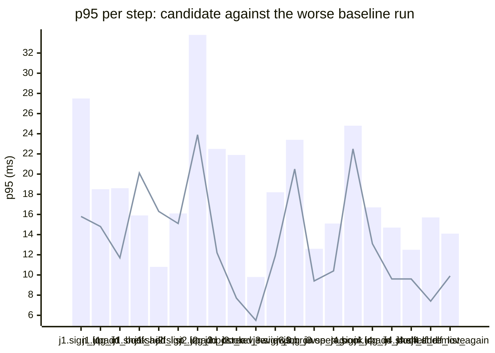

### Downstream report

Candidate `61fb94ad` against baseline `0fa756eb`. Run started 2026-10-23T03:29:47Z, ended 2026-10-23T03:29:54Z. 2 VUs, 10 iterations per VU per pass (cap 60 s), k6 v0.56.0 (commit/50afb99947, go1.23.4, linux/amd64).

**Findings:** regressed steps 0, trade-off journeys 0, improved metrics 0, withheld metrics 5.

#### A new reader signs up, logs in, adds a book and puts it on their shelf

| Step | Baseline p95 (B1 / B2) | Candidate p95 | Change | Noise band | Verdict |
|---|---|---|---|---|---|
| `sign_up` | 21.6 / 27.5 ms | 15.8 ms | -11.7 ms (-43%) | 5.8 ms | noise |
| `log_in` | 18.5 / 14.3 ms | 14.8 ms | -3.7 ms (-20%) | 4.1 ms | noise |
| `add_book` | 18.6 / 10.7 ms | 11.7 ms | -7.0 ms (-37%) | 8.0 ms | noise |
| `shelf_add` | 15.9 / 8.6 ms | 20.1 ms | +4.2 ms (+26%) | 7.3 ms | noise |
| `shelf_list` | 10.8 / 10.4 ms | 16.3 ms | +5.5 ms (+51%) | 0.3 ms | noise |

#### A reader logs in, reviews a book and reads the reviews

| Step | Baseline p95 (B1 / B2) | Candidate p95 | Change | Noise band | Verdict |
|---|---|---|---|---|---|
| `sign_up` | 16.1 / 13.8 ms | 15.1 ms | -0.9 ms (-6%) | 2.3 ms | noise |
| `log_in` | 33.8 / 13.6 ms | 23.9 ms | -9.9 ms (-29%) | 20.2 ms | withheld |
| `add_book` | 22.5 / 13.6 ms | 12.2 ms | -10.2 ms (-46%) | 8.9 ms | noise |
| `post_review` | 13.2 / 21.9 ms | 7.7 ms | -14.2 ms (-65%) | 8.6 ms | noise |
| `read_reviews` | 9.8 / 8.0 ms | 5.5 ms | -4.3 ms (-44%) | 1.9 ms | noise |

#### A visitor browses books by tag and opens one

| Step | Baseline p95 (B1 / B2) | Candidate p95 | Change | Noise band | Verdict |
|---|---|---|---|---|---|
| `sign_up` | 18.2 / 13.4 ms | 11.9 ms | -6.3 ms (-35%) | 4.8 ms | noise |
| `log_in` | 23.4 / 12.6 ms | 20.5 ms | -2.9 ms (-12%) | 10.9 ms | withheld |
| `add_book` | 27.4 / 11.6 ms | 11.9 ms | -15.5 ms (-57%) | 15.8 ms | withheld |
| `browse_tag` | 10.4 / 12.6 ms | 9.4 ms | -3.3 ms (-26%) | 2.3 ms | noise |
| `open_book` | 15.1 / 5.2 ms | 10.4 ms | -4.7 ms (-31%) | 9.9 ms | noise |

#### A reader views their shelf and removes a book

| Step | Baseline p95 (B1 / B2) | Candidate p95 | Change | Noise band | Verdict |
|---|---|---|---|---|---|
| `sign_up` | 24.8 / 15.1 ms | 22.5 ms | -2.3 ms (-9%) | 9.7 ms | noise |
| `log_in` | 16.7 / 13.8 ms | 13.1 ms | -3.7 ms (-22%) | 2.9 ms | noise |
| `add_book` | 14.5 / 14.7 ms | 9.6 ms | -5.1 ms (-35%) | 0.1 ms | noise |
| `shelf_add` | 12.5 / 7.3 ms | 9.6 ms | -2.9 ms (-23%) | 5.2 ms | noise |
| `shelf_list` | 26.2 / 12.0 ms | 8.1 ms | -18.1 ms (-69%) | 14.2 ms | withheld |
| `shelf_remove` | 15.7 / 5.8 ms | 7.4 ms | -8.4 ms (-53%) | 9.9 ms | noise |
| `shelf_list_again` | 14.1 / 3.1 ms | 9.9 ms | -4.3 ms (-30%) | 11.1 ms | withheld |

**App process**

| Metric | B1 | C | B2 | Change | Noise band | Verdict |
|---|---|---|---|---|---|---|
| CPU time | 1.26 s | 0.94 s | 0.96 s | -0.32 s (-25%) | 0.30 s | noise |
| Peak RSS | 8.0 MB | 7.9 MB | 8.1 MB | -0.2 MB (-3%) | 0.1 MB | noise |

**p95 per step**

Bars: worse of the two baseline runs. Line: candidate.
The chart shows the 20 steps with the largest change, out of 22.

- j1: A new reader signs up, logs in, adds a book and puts it on their shelf
- j2: A reader logs in, reviews a book and reads the reviews
- j3: A visitor browses books by tag and opens one
- j4: A reader views their shelf and removes a book

**Issues to open**

none

**Discarded journeys**

none

**Blast radius**

Changed routes:

- `GET /health`: handler (Server).handleHealth itself changed

Affected routes:

- none

*static analysis with go/ast, calls resolved by name, depth 2 from handlers and middleware, a function reached by more than half of all routes is ignored when looking for shared functions; misses dynamic registration, reflection, interface dispatch by other names, and cross-service calls*

**Not measured**

- DB time: not measured; the target exposes no database timing.

**Method.** Baseline run twice (B1, B2) and candidate once (C), in the order B1, C, B2, sequentially on one machine. Three runs give no confidence interval; treat verdicts near the thresholds as uncertain.

Thresholds in effect: a metric is a regression when the candidate is worse than the worse baseline run by more than 2 times the noise band (the difference between B1 and B2), by at least 20%, and by at least 10 ms (latency), 10 MB (memory) or 0.5 s (CPU). A step that passed on both baseline runs and failed on the candidate is a regression. The verdict is withheld when the baseline runs differ by more than 50% of the smaller one and by at least the same minimum, unless the candidate is clearly worse or better than both. A journey with a latency regression and a latency improvement is reported as a trade-off.
